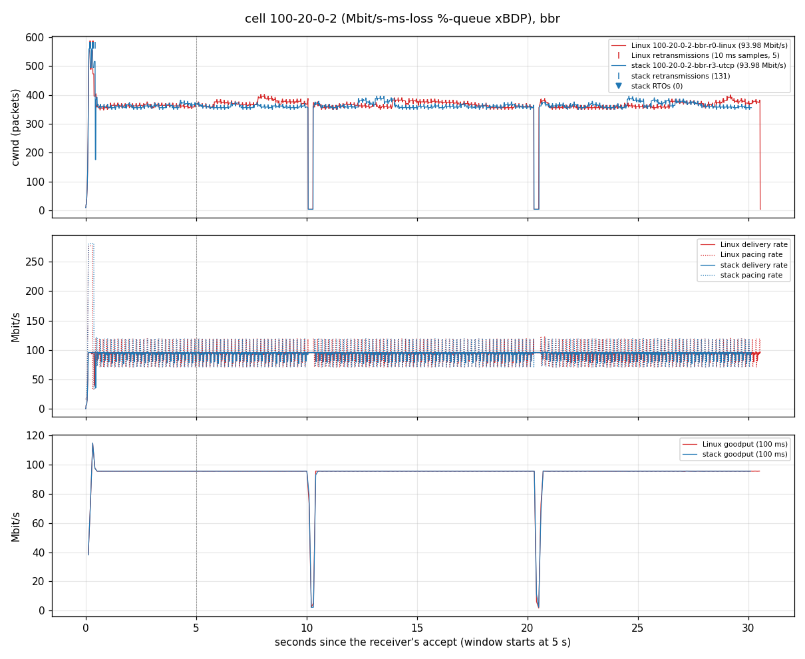

# Comparison results (M2)

The stack against Linux 7.0 on the comparison testbed (DESIGN §14). Sections and owners (M2 work
breakdown): Method, Calibration, Gap rule and thresholds, Which runs count, Timing hygiene (m2d-testbed);
Comparison with Linux traces (m2-integrate); Checkpoint (m2-checkpoint); Core matrix (m2d-matrix);
Multi-flow (m2d-multiflow); Ablation (m2d-ablation).

"Gap rule and thresholds" and "Which runs count" are fixed before the first matrix run and are not
changed afterwards; the commit that fixed them is named in each.

## Method

**Topology** (`testbed/m2/`, DESIGN §14). Per slot four containers from `utcp-testbed:dev`, sender
`snd`, routers `r1` and `r2`, receiver `rcv`, on three Docker bridge networks:

```
snd --(a)-- r1 --(b)-- r2 --(c)-- rcv      netem on r1's b side (data direction), tbf on r2's c side
slot N: a = 198.19.X.0/24, b = X+1, c = X+2, X = 10+4N (slots 0, 1); the stack on TUN utcpK in snd, 198.18.(8N+K).2
```

The Linux sender is the kernel of `snd`; the stack runs in the same container on a TUN device, so both
senders share the path, the receiver and the ping probe. The receiver is always Linux
(`utcp-bulk --backend kernel --recv`). No default routes and permanent neighbour entries between the
hops: every packet crosses both routers and no ARP crosses netem.

**Path of one run** (`testbed/m2/shape.sh`, created fresh for every run):
- r1 → r2: `netem limit 20000 delay RTTms [loss random P% seed S]`, the whole base RTT and all loss. No
  jitter (no reordering). The ACK direction has no qdisc, delay or loss.
- r2 → rcv: `tbf rate BWmbit burst B limit Q`, B = max(2·1514, BW · 1 ms) bytes, Q = the cell's queue in
  bytes. tbf counts the 14-byte Ethernet header: a full frame is 1514 bytes and payload efficiency at
  most 1448/1514 = 95.6 %.
- Sender: veth `noqueue`, tso and gso off; routers and receiver: gro off; TUNs `pfifo limit 10000`,
  `txqueuelen 10000`.
- Buffers: sender `tcp_wmem = 4096 16384 67108864`, receiver `tcp_rmem` default `4096 131072 33554432`,
  `tcp_no_metrics_save = 1` and `ip tcp_metrics flush` before each run on both.

**Cells.** Bandwidth {10, 100} Mbit/s × RTT {20, 100} ms × loss {0, 0.1, 1} % × queue {0.5, 2} × BDP,
BDP = BW · RTT / 8 (25 000, 125 000, 250 000 and 1 250 000 bytes); 30 s runs at 20 ms, 60 s at 100 ms.
The netem seed is the same for the stack run and the Linux run of one (cell, algorithm, repetition)
and differs between repetitions; pings share the qdisc, so equal seeds mean equal loss processes, not
equal dropped segments.

**One run** (`tools/m2/matrix.py`): shape; `record.sh` before; captures and the tbf sampler start; the
receiver listens; `ping -D -O -i 0.05 -s 56` from `snd` to `rcv` starts 3 s before the sender; the
sender (`utcp-bulk --send --duration S --sample-ms 10`, `--cc X`) runs; `record.sh` after; analysis.
The ping RTTs are taken from the r1-in capture, which sees each echo request and its reply (paired by
ICMP id and sequence, nanosecond timestamps): iputils prints RTTs of 100 ms and more as whole
milliseconds (10-100 ms with 0.1 ms), too coarse for the 100 ms cells. The capture RTT leaves out the
two sender-r1 veth hops (microseconds), which the run's idle base removes as well; `ping.txt` is used
only for a run without the capture. The
stack sender also gets `--set snd_buf_max=64Mi --set rcv_buf_max=32Mi --set gso_max_size=G` (G from the
sender interface's measured `gso_ipv4_max_size`, DESIGN §14.6), `--stats` and `--trace` (retransmissions
and RTOs, kept in memory and written at exit). Plans (`matrix.py run PLAN.toml`, DESIGN §14.7) run each
stack run and the Linux run of the same cell, algorithm and repetition back to back in one slot with one
netem seed; the group order, the netem seeds and the order inside each pair come from the plan's seed.
An invalid group is rerun as a whole right after it (both runs, the same seed and order). `run` refuses
two slots at once (the serial decision below), a non-timing slot unless told (`--nontiming`, the runs
are marked `timing` false), a slot without a passing calibration gate of the same reuse key (`--gate`;
`--no-gate` only outside timing campaigns), and a campaign with runs of another reuse key (`--rekey`
moves those groups aside and reruns them).

**Window.** Every metric uses [t₀ + 5 s, t_end] on CLOCK_MONOTONIC, t₀ = the receiver's accept time (the
`start` line of its JSONL), t_end = min(t₀ + S, the sender's `start` line + S). The sender writes for S
from its own start (its connect returning), which is one RTT before t₀ because all delay is on the data
path; t₀ + S alone would put that RTT after the last write into the window. Counters at the bounds are
interpolated linearly between the 10 ms samples. The drain after the sender stops writing is outside
the window. CLOCK_REALTIME times (captures, ping, the tbf sampler) convert with the clock pair that
`utcp-bulk` writes first in its JSONL.

**Metrics** (`tools/m2/analyze.py`):

| Metric | Definition | Source |
|---|---|---|
| Goodput | Δ`bytes_received` over the window × 8 / window length | receiver JSONL |
| Retransmission rate | Δ`total_retrans` / Δ`data_segs_out` over the window, in % | sender JSONL (same keys for both senders); cross-check below |
| Spurious retransmissions | Δ`dsack_dups` over the window | sender JSONL |
| Queueing delay p50, p99 | ping RTT − base over pings sent in the window; base = median of the replies received before t₀ (3 s idle); lost pings counted, excluded | echo requests and replies in the r1-in capture (`ping.txt` without it) |
| sndbuf-, rwnd-limited time | Δ`sndbuf_limited_us`, Δ`rwnd_limited_us` / window | sender JSONL |
| Jain index | (Σx)² / (n·Σx²) over per-flow goodput in [t_join + 20 s, t₀ + S] | receiver JSONL per flow |
| Convergence time | first t after flow n's join from which every flow's 1 s mean goodput (100 ms steps) stays within ±20 % of C/n for 5 s; "not converged" if none | receiver JSONL per flow |
| Loop lateness p99, max | the stack's EventLoop histogram | `utcp-bulk` summary; the histogram in `--stats` |
| Sender counters | `TcpRetransSegs`, `TcpExtTCPSackRecovery`, `TcpExtTCPLossProbes`, `TcpExtTCPTimeouts`, ... (same names) | Linux: the sender's `nstat` before and after; stack: `--stats` |
| Testbed counters | netem and tbf sent/dropped, tbf backlog (10 ms sampler), interface and qdisc drops, softnet drops and time_squeeze on the slot CPUs, `nstat`; the stack's device errors (invalid) and transmit-queue or pool waits (`loop_pending_calls`, flagged) | `record.sh` before and after, `tbf.txt`, `--stats` |
| Softirq time on slot CPUs | Δ irq and softirq jiffies of the slot CPUs; Δ NET_RX, NET_TX, HRTIMER, TIMER | `/proc/stat`, `/proc/softirqs` in `record.sh` |
| Foreign CPU time | CPU time on the slot CPUs that is not the run's, as a fraction of their time: lower bound Δbusy − Δirq − Δsoftirq − Δ(the four containers' cgroup usage), upper bound Δbusy − Δcontainers (the kernel samples irq time per tick, so softirq that interrupted our tasks is in both) | `/proc/stat` and each container's `cpu.stat` `usage_usec` in `record.sh` |
| Capture cross-check | over the window: data segments and retransmissions in the r1-in capture against the sender's Δ`data_segs_out` and Δ`total_retrans`, data segments in r2-out against the receiver's Δ`data_segs_in`; a difference above max(20, 0.1 %) segments (retransmissions max(3, 5 %)) is flagged | captures (10 ms bins in `capture.json`), JSONL |

Percentiles interpolate linearly between closest ranks.

**Captures.** `tcpdump -s 128 'not ether multicast'` on r1's interface from the sender (`r1-in`) and on
r2's interface to the receiver (`r2-out`), calibration also r1's interface toward r2 after netem
(`r1-out`), written to the `utcp-data` volume under `/m2/<campaign>/<run>/`; the runner logs each
capture's size. Each capture's `packets dropped by kernel` and `packets received by filter` versus
`captured` are checked; tcpdump is stopped 1.5 s after the pings, which stop once the connection has
closed at both ends, so that its 1 s ring blocks are delivered.

**Raw data and archive.** Per run in the volume: `meta.json` (cell, implementation, algorithm,
repetition, order, slot, start time, kernel, image id, commit, binary and core-library sha256, build,
iproute2, cpusets, tbf B and Q, netem line and seed, uptime and top CPU users, for the stack the `--set`
list and the measured `gso_ipv4_max_size`, reuse key), `snd.jsonl`, `rcv.jsonl`, `ping.txt`, `tbf.txt`,
`pre/` and `post/record.txt`, the captures, `capture.json`, for the stack `stats.json` and `trace.jsonl`,
and `summary.json`. `meta.json` also has the algorithm label, the plan group and rerun number, `timing`
and the calibration gate the run relied on. In the repository
`docs/results/m2-<campaign>/runs.csv` and `cells.csv`. The analysis archive (every input except the
captures, with a sha256 manifest) goes to `/m2/archive/` in the volume; `analyze.py tables --archive`
regenerates `runs.csv` and `cells.csv` byte for byte from it.

**Reuse key.** sha256 over the `utcp-bulk` binary and core library hashes, the build, `uname -r`, the
image id, a hash of `testbed/m2` and `tools/m2`, and the containers' `net.ipv4.tcp_*`/`net.core.*`
sysctls and the `tcp_cubic`/`tcp_bbr` module parameters. A run is reused in a later campaign only with
an equal key; otherwise both sides of the cell rerun. `matrix.py run` compares every finished run of the
plan with the key it would give now and refuses a mix; `cells.csv` lists the keys of each cell's counted
runs and marks a cell with more than one "mixed reuse keys" (no verdict).

## Calibration

### Calibration for the BBRv1 release build

The measured source was `769311e157dea0e7983a2cd5bd086736339dc62b`. Each slot independently
produced reuse key `f0ecf3e4882789e261bb9fa8a3da91adf519b7b0f8f2c8d9b8dbfee286c1013e`.
Slot 0 ran first, followed by slot 1. Both live consumers accepted all 62 source fingerprints.
Each gate ran 26 transfers and ten 200-ping idle tests. The 52 endpoint checksum pairs matched,
all 4,000 pings returned, and every receiver window reproduced its reported goodput.

| Slot | Checks passed | NewReno default / capped (Mbit/s) | Gate minimum (Mbit/s) | Physical / filter packets in 68 transfer captures | Kernel capture drops | Transfers flagged for foreign CPU |
|---:|---:|---:|---:|---:|---:|---:|
| 0 | 67/67 | 95.625717 / 95.617610 | 93.727873 | 8,414,337 / 8,414,337 | 0 | 20/26 |
| 1 | 67/67 | 95.625493 / 95.617741 | 93.727873 | 8,420,356 / 8,420,356 | 0 | 16/26 |

The deliberate 400,000-byte send-buffer cap flagged 4.194% and 4.038% send-buffer-limited
time on slots 0 and 1. The default path measured zero on each slot. The gate applied its capture
accounting to the individual interfaces on each transfer. Compact receipts include the original
campaign paths, source-index digests, capture replay digests and archive SHA-256 values.
[Calibration and restore records](results/m2-bbr/README.md)

The calibration gate (M2 design §5.4, DESIGN §14.4), Linux to Linux (CUBIC) for items 1-5 and the stack
for item 6, run on slot 0 and then on slot 1 on 2026-11-14 with commit d713941, kernel 7.0.0-42-generic,
image `utcp-testbed:dev` (`sha256:42acf2a264d9`), `utcp-bulk` from `build/tb-gcc-release`:

```
testbed/m2/up.sh --slot 0; testbed/m2/up.sh --slot 1
UTCP_M2_JOB=utcp-m2d-testbed tools/m2/matrix.py calibrate --slot 0 --campaign m2d-testbed/calib-s0
UTCP_M2_JOB=utcp-m2d-testbed tools/m2/matrix.py calibrate --slot 1 --campaign m2d-testbed/calib-s1
tools/m2/matrix.py gate-table --campaign m2d-testbed/calib-s0 --campaign m2d-testbed/calib-s1
```

Every run's files are in the `utcp-data` volume under `/m2/m2d-testbed/calib-s{0,1}/`, with `gate.json`
and the per-item table `gate.md`. Items and pass conditions:

1. Idle ping, 200 at 50 ms: median within [RTT, RTT + 1 ms], p99 ≤ RTT + 2 ms. Since 2026-11-16 the
   RTTs come from a capture next to the pinging end (r1's sender side; for item 6's ping from the
   receiver, r2's receiver side); the table below is from ping's own output, whole milliseconds at
   100 ms.
2. One Linux CUBIC flow, 0 % loss: goodput ≥ 98 % of the payload rate (BW · 1448/1514), gated with the 2×BDP
   queue; the 0.5×BDP value is reported.
3. Loss 0.1 % and 1 % (Linux CUBIC, both queues): data segments lost on the netem hop, counted as r1-in
   minus r1-out in the captures, inside the exact binomial interval for the offered count at
   α = 0.01/16 (Bonferroni over the 16 tests). Both captures must be complete (0 dropped by the kernel,
   every packet the filter received written), since a packet missing from r1-out would count as a
   netem loss; the gate below predates this check (its captures had 0 kernel drops; the 4 incomplete
   ones are listed under the table).
4. In item 2's run: the tbf backlog reaches [0.9, 1] · Q; at every drop it reaches the tail-drop bound
   (no drop interval with the sampled backlog below Q − 1514 − B − BW · Δt, Δt the sample spacing); and
   ping max − base is within 10 % of the largest backlog a ping can find,
   ((Q − 98) div 1514 · 1514 + 98) · 8 / BW. Where Q ≤ 1514 + B + BW · Δt the bound is not positive and
   any backlog meets it: at 10 ms sampling that is the 0.5×BDP queue at 10 Mbit/s, 20 ms (Q 12 500 B,
   lowest bound −8 272 and −8 746 B on slots 0 and 1) and at 100 Mbit/s, 20 ms (Q 125 000 B, −48 027 and
   −52 989 B). In those two cells the drop check was not testable and item 4 rests on the backlog
   reaching 0.9 · Q and on the ping; `gate.md` now says "not testable at 10 ms sampling" there.
5. In every run of items 2-3: no interface, qdisc or softnet drop, no `time_squeeze`, no capture drop.
6. The stack: idle ping from the receiver to the stack within 0.2 ms of the kernel's; one stack NewReno run
   at 100 Mbit/s, 20 ms, 0 %, 2×BDP with goodput at item 2's threshold, no drops, no device errors.

| Slot | BW, RTT, queue | 1: ping median / p99 (ms) | 2: goodput, % of BW | 4: backlog max, % of Q; ping max - base / target (ms) | 3: loss % at 0.1 / 1 (lost segments in the accepted interval) | 5: drops, squeeze | Pass |
|---|---|---|---|---|---|---|---|
| 0 | 10 Mbit/s, 20 ms, 2xBDP | 20.10 / 20.20 | 95.49 | 99.9; 38.7 / 38.8 | 0.092 (23 in [10, 44]) / 1.058 (161 in [112, 196]) | 0 of 3 runs | yes |
| 0 | 10 Mbit/s, 20 ms, 0.5xBDP | 20.10 / 20.10 | 95.48 (not gated) | 97.7; 9.2 / 9.8 | 0.089 (22 in [10, 43]) / 0.968 (155 in [119, 205]) | 0 of 3 runs | yes |
| 0 | 10 Mbit/s, 100 ms, 2xBDP | 100.00 / 100.00 | 95.50 | 99.5; 198.0 / 199.9 | 0.112 (35 in [14, 52]) / 1.025 (68 in [40, 96]) | 0 of 3 runs | yes |
| 0 | 10 Mbit/s, 100 ms, 0.5xBDP | 100.00 / 100.00 | 95.49 (not gated) | 99.5; 49.0 / 49.7 | 0.137 (31 in [8, 41]) / 1.069 (73 in [42, 98]) | 0 of 3 runs | yes |
| 0 | 100 Mbit/s, 20 ms, 2xBDP | 20.10 / 20.20 | 95.63 | 99.6; 39.2 / 40.0 | 0.097 (60 in [37, 91]) / 1.088 (179 in [123, 210]) | 0 of 3 runs | yes |
| 0 | 100 Mbit/s, 20 ms, 0.5xBDP | 20.10 / 20.20 | 95.63 (not gated) | 99.3; 9.1 / 9.9 | 0.086 (56 in [39, 94]) / 0.899 (163 in [137, 229]) | 0 of 3 runs | yes |
| 0 | 100 Mbit/s, 100 ms, 2xBDP | 100.00 / 100.00 | 95.63 | 99.9; 200.0 / 200.0 | 0.083 (42 in [28, 77]) / 0.914 (74 in [52, 113]) | 0 of 3 runs | yes |
| 0 | 100 Mbit/s, 100 ms, 0.5xBDP | 100.00 / 100.00 | 95.63 (not gated) | 99.8; 50.0 / 49.9 | 0.137 (28 in [7, 37]) / 0.837 (75 in [59, 123]) | 0 of 3 runs | yes |
| 1 | 10 Mbit/s, 20 ms, 2xBDP | 20.10 / 20.20 | 95.49 | 99.9; 38.7 / 38.8 | 0.092 (23 in [10, 44]) / 1.065 (163 in [113, 197]) | 0 of 3 runs | yes |
| 1 | 10 Mbit/s, 20 ms, 0.5xBDP | 20.10 / 20.20 | 95.48 (not gated) | 97.7; 9.0 / 9.8 | 0.093 (23 in [10, 43]) / 0.948 (153 in [120, 206]) | 0 of 3 runs | yes |
| 1 | 10 Mbit/s, 100 ms, 2xBDP | 100.00 / 100.00 | 95.50 | 99.5; 198.0 / 199.9 | 0.108 (35 in [15, 53]) / 1.098 (69 in [38, 91]) | 0 of 3 runs | yes |
| 1 | 10 Mbit/s, 100 ms, 0.5xBDP | 100.00 / 100.00 | 95.49 (not gated) | 99.5; 49.0 / 49.7 | 0.130 (30 in [9, 41]) / 1.142 (74 in [39, 94]) | 0 of 3 runs | yes |
| 1 | 100 Mbit/s, 20 ms, 2xBDP | 20.10 / 20.20 | 95.63 | 99.9; 39.2 / 40.0 | 0.097 (61 in [37, 91]) / 1.066 (174 in [122, 208]) | 0 of 3 runs | yes |
| 1 | 100 Mbit/s, 20 ms, 0.5xBDP | 20.10 / 20.20 | 95.61 (not gated) | 99.4; 9.2 / 9.9 | 0.086 (56 in [39, 94]) / 0.912 (166 in [138, 230]) | 0 of 3 runs | yes |
| 1 | 100 Mbit/s, 100 ms, 2xBDP | 100.00 / 100.00 | 95.63 | 99.9; 200.0 / 200.0 | 0.078 (40 in [29, 78]) / 0.923 (71 in [49, 108]) | 0 of 3 runs | yes |
| 1 | 100 Mbit/s, 100 ms, 0.5xBDP | 100.00 / 100.00 | 95.63 (not gated) | 99.6; 50.0 / 49.9 | 0.125 (26 in [7, 38]) / 0.904 (83 in [61, 126]) | 0 of 3 runs | yes |

| Slot | Item 6 part | Result | Pass |
|---|---|---|---|
| 0 | ping | idle ping median rcv to stack 20.1 ms, snd kernel to rcv 20.1 ms | yes |
| 0 | run | stack NewReno 100 Mbit/s, 20 ms, 0 %, 2xBDP: 65.42 Mbit/s (threshold 93.73); retransmitted 0.29 %; rwnd-limited 20.7 %, sndbuf-limited 0.0 %; loop lateness p99 bucket <= 32767 ns; drops none | NO |
| 0 | path | stack NewReno 100 Mbit/s, 20 ms, 0 %, 2xBDP, --snd-buf 400000: 95.62 Mbit/s (threshold 93.73); retransmitted 0.00 %; rwnd-limited 0.0 %, sndbuf-limited 4.1 %; loop lateness p99 bucket <= 524287 ns; drops none | yes |
| 1 | ping | idle ping median rcv to stack 20.2 ms, snd kernel to rcv 20.1 ms | yes |
| 1 | run | stack NewReno 100 Mbit/s, 20 ms, 0 %, 2xBDP: 66.54 Mbit/s (threshold 93.73); retransmitted 0.28 %; rwnd-limited 19.7 %, sndbuf-limited 0.0 %; loop lateness p99 bucket <= 262143 ns; drops none | NO |
| 1 | path | stack NewReno 100 Mbit/s, 20 ms, 0 %, 2xBDP, --snd-buf 400000: 95.62 Mbit/s (threshold 93.73); retransmitted 0.00 %; rwnd-limited 0.0 %, sndbuf-limited 7.7 %; loop lateness p99 bucket <= 1048575 ns; drops none | yes |

**First calibration, November 14.** Items 1-5 (Linux to Linux) passed on both slots in all 8 (bandwidth, RTT, queue) cells. Item 6
passes its ping part and fails its run on both slots: the stack (M1 code) reaches 65.4 and 66.5 Mbit/s
against the 93.73 Mbit/s threshold. NewReno's slow-start overshoot overflows the 2×BDP queue (0.28-0.29 %
of segments retransmitted, 647 and 632 tbf drops), and the M1 sender's recovery repairs about one hole
per RTT (INTEROP.md open items), so the receiver's window stops advancing and the sender is
rwnd-limited for 20 % of the window. The same run
with the stack's send buffer at 400 000 B (below BDP + queue, no loss) carries 95.62 Mbit/s on both
slots. Each historical gate retained 66 passing rows and the failed default-buffer transfer.

Captures: 68 per slot, 996.7 MB (slot 0) and 996.4 MB (slot 1) in total, at most 95.6 MB for one
capture; 0 packets dropped by kernel in every one. In 4 runs (1 on slot 0, 3 on slot 1) 1 to 5 packets
were counted by the filter and not written (flag `capture_incomplete`); the last packets in those
captures are the host's SSDP multicast (`198.19.X.1 > 239.255.255.250.1900`), which arrives in bursts
and sat in the last ring block. The gate's captures were taken without a filter; since then the runner
captures with `not ether multicast`. The netem drop counter exceeds the data segments lost on the
netem hop by the pings it dropped. Item 4's ping maxima are within 0.8 ms of the attainable target.

**Testbed checks.** `tests/interop/m2_testbed.sh --slot 0` and `--slot 1` after the gate (commit 1b0105f):
106 checks ok on each, none failed: containers, networks, addresses, routes, cpusets and sysctls; every
`record.sh` item; `shape.sh` for the 8 (bandwidth, RTT, queue) combinations at 0, 0.1 and 1 % loss;
2000 pings at 10 % loss with seed 1234 twice lose the same `icmp_seq` set and seed 1235 a different one;
`down.sh` removes exactly the slot.

**Scripted drops** (§4.2, `testbed/m2/drop.sh`, `tests/interop/m2_testbed_drops.sh`, M2 tasks test 10), on
the non-timing slot 2 with the Linux sender, 100 Mbit/s, 20 ms, a 40×BDP queue, 5 MB per run; what r1
(and r2) dropped is read from the captures before and after the router with `tools/m2/dropcheck.py`, which
also computes from the capture before the router which segments the rule must latch (DESIGN §14.5).

The first version (up to commit 80ee74e) matched the exact sequence ISN + 1 + OFF. It dropped nothing in
3 runs (one copy-1 run of the fix pass, two copy-12 runs of the three verification passes): the Linux
sender sent a short segment earlier in the stream (1360 B at offset 192 584, 512 B at 195 480, 840 B at
440 192), so offset 1 448 000 was no segment start. Replayed on the two verification captures, the current
rule latches 1 448 512 and 1 448 840, the first starts at or after the offset. Its watcher, `tcpdump -c 1`,
armed 21-64 ms after the SYN (54 logs, including 5 passes of the range rule with that watcher, all PASS),
more than the 20 ms RTT.

Current version (a target latches the first segment start in [OFF, OFF + N·1448); AF_PACKET watcher):
`tests/interop/m2_testbed_drops.sh --slot 2 --campaign m2d-testbed/refix-drops11` .. `refix-drops15`, five
passes in a row on 2026-11-17, all PASS (6 cases each). Each capture complete (90 captures, received by
filter = captured, 0 dropped by kernel). The watchers armed 2.2-2.7 ms after the SYN. Per pass:

| Case | Armed | Dropped by r1 (offset, copy) | Dropped by r2 | Result |
|---|---|---|---|---|
| copy1 | r1: offset 1 448 000, copy 1 | 1 448 000, copy 1 (#1003-#1004 in r1-in) | none | 5/5 pass |
| copy2 | r1: offset 1 448 000, copy 2; r2: copy 1 | 1 448 000, copy 2 (#1290-#1329) | 1 448 000, copy 1 (#1003 of r1-out) | 5/5 pass |
| copy12 | r1: offset 1 448 000, copies 1 and 2 | 1 448 000, copies 1 and 2 | none | 5/5 pass |
| mid | r1: offset 1 448 700, copy 1 | 1 449 448, copy 1 (the next segment start) | none | 5/5 pass |
| burst | r1: offset 2 896 000, 5 segments, copy 1 | 2 896 000 + 1448·k, k = 0..4, copy 1 | none | 5/5 pass |
| ct | r1: `ct original packets 500` | #500, offset 716 760-719 656, copy 1 (a first transmission) | none | 5/5 pass |

No pass had a short segment before its target, so the shifted-boundary case was exercised live only by
`mid` (an offset that is no segment start) and offline by the replay above. These 5 MB runs are shorter than
the analysis window, so `summary.json` marks them invalid for the statistics; they are mechanism checks only.

### Integrated calibration, November 19, 2026

Both slots passed on commit `3f48c30dbf70240d50234f095eaca6de24fc0625`. Each full calibration
covered all eight bandwidth, RTT and queue combinations, both loss rates, and both stack NewReno
transfers. The fixed stack goodput threshold was 93.727873 Mbit/s. Each gate consumer rechecked
62 source fingerprints. The separate slot 0 diagnostic on `8facd285` passed 67/67 under key
`96d5b26f1e9db5fd7e971c8a5a304c420fb1605078a7ff8ce5d9c82bcfddcff7`.
Its default and capped rates were 95.625960 and 95.617249 Mbit/s. Its peer slot and proof were
never acquired. The November 14 runs above each passed 66/67. Their original gate JSON files
under `/m2/m2d-testbed/calib-s{0,1}/` retain SHA-256
`1cc7cd9ba1cd19decaf2c13f61eb02529b8b637b29efbaa8d920d6ec23f95631` and
`167490c922089a8a719e0e0e9a24bca82393aea3b119f7571d5fba34bc1637d2`, respectively.

| Final slot | Passing rows by item 1–6 | Default / capped NewReno (Mbit/s) | Stack / kernel idle medians (ms) | Signed difference (ms) |
|---|---|---:|---:|---:|
| 0 | 8 / 8 / 16 / 8 / 24 / 3 | 95.625513 / 95.617723 | 20.0906315 / 20.0544080 | +0.0362235 |
| 1 | 8 / 8 / 16 / 8 / 24 / 3 | 95.625965 / 95.617396 | 20.0836445 / 20.0569400 | +0.0267045 |

| BW (Mbit/s) | RTT (ms) | Queue (×BDP) | Linux goodput, slots 0 / 1 (Mbit/s) | Idle ping p99, slots 0 / 1 (ms) |
|---:|---:|---:|---:|---:|
| 10 | 20 | 0.5 | 9.5491 / 9.5491 | 20.1309 / 20.1870 |
| 10 | 20 | 2 | 9.5491 / 9.5492 | 20.1719 / 20.1961 |
| 10 | 100 | 0.5 | 9.5495 / 9.5495 | 100.1210 / 100.2120 |
| 10 | 100 | 2 | 9.5495 / 9.5497 | 100.1410 / 100.1984 |
| 100 | 20 | 0.5 | 95.6255 / 95.6236 | 20.1601 / 20.1459 |
| 100 | 20 | 2 | 95.6255 / 95.6255 | 20.1991 / 20.2141 |
| 100 | 100 | 0.5 | 95.6258 / 95.6260 | 100.1327 / 100.1237 |
| 100 | 100 | 2 | 95.6264 / 96.1082 | 100.1745 / 100.1790 |

Slot 1's 96.1082 Mbit/s value comes from the receiver's TCP_INFO counter. The router capture
shows 3,307,232 unique bytes already above the first hole at the start of the window. Closing
the holes credited those buffered bytes during the window. At the end, all captured bytes formed
one contiguous sequence. The TCP payload actually crossing the router in the 54.899956 s window
measured 95.626314 Mbit/s.

Each slot had 24 connected Linux CUBIC senders and two stack NewReno senders. All 52 transfers
had matching endpoint byte counts and SHA-256. Independent interpolation of the receiver samples
reproduced all reported goodputs. Each run covered both ends of its measured window.
Reparsing the 136 transfer captures recovered 16,840,981 records. All filter and captured
counts matched, with zero kernel capture drops. The 20 separate idle wire captures contained
4,000 replies to 4,000 requests. The kernel controls probed the receiver from the sender.
The stack probes ran from the Linux receiver to the stack TUN address. Default sndbuf-limited time
was zero on both slots. The 400,000-byte controls spent 3.761% and 3.840% of their respective
windows sndbuf-limited. All four transfers had zero rwnd-limited time.

The canonical GCC 15.2 release build used `-O3 -DNDEBUG` in container path
`/home/postedism/Desktop/utcp-wt/int-wire40`. Its executable and core library matched the
functional-test build and the archived diagnostic binaries byte for byte. The 429-file source
snapshot was checked against the Git tree on both hosts. Both live slots had the same key,
`cd50db51c944442c8f1158f6b5e48f01ab3f913d9b96034a675af9a8aed9c1fd`.
The kernel was `7.0.0-42-generic`, with scripts digest
`43bf359c7ba1bf5d40f3a58ef7c4c9e5ba82737038b6d25ba35aa52d55b72912` and sysctl/module digest
`795239ee27aa80ccc53bfffd887dddc48aaba8497ce72e08c1f23e1320cbadcf`. The topology records
show sender veth TSO/GSO off and forwarding-interface GRO off. The sender had a 64 MiB TCP
send-buffer maximum, the receiver a 32 MiB receive-buffer maximum, and both had
`tcp_no_metrics_save=1`.

The runs were acquired serially on the assigned topologies. For a clean reproduction use a fresh
campaign name with the same frozen inputs. The original invocations were

```sh
set -euo pipefail
export UTCP_M2_PREFIX=utcp-m2-finalgate UTCP_M2_JOB=utcp-m2-finalgate-runner
sha=3f48c30dbf70240d50234f095eaca6de24fc0625
for n in 0 1; do
    taskset -c 16-31 nice -n 10 python3 tools/m2/matrix.py calibrate \
        --slot "$n" --campaign "m2-integrate/${sha}-calib-a1-s$n"
done
```

The raw roots in `utcp-data` are `/m2/m2-integrate/${sha}-calib-a1-s{0,1}/`.
The corresponding `/m2/archive/m2-integrate-${sha}-calib-a1-s{0,1}-audit-1/` directories
hold the non-pcap inputs and per-file raw indices. Adjacent `-physical-a1/` directories
hold the independent packet counts, RTTs, load and per-run statistics.

| Slot | Gate JSON SHA-256 | Compact analysis archive SHA-256 |
|---|---|---|
| 0 | `a3f4d37564f8fea9704c69775c63fec05e61e05cebb3f2d18fba7e80dbb596d8` | `b6d15cdb97fec301583606b1142281c12b77c93bfabfb278ace438bccc94324b` |
| 1 | `8049131065bc7d9c9956beb4ba51009daf79168feabc36303f4b620d761d0c3d` | `4e7ba3c7838078f662f41006b16b7f1b0b8b435343e94d3148a6f43577132c74` |

The original diagnostic gate JSON has SHA-256
`801093b249e62b7e4ac0b7e8851d3e82a99cab22fa26683dfadb69de9f8ae053` in
`/m2/m2-integrate/8facd2852d3d42c77a8204e2cf7d6ae28a7044c7-calib-a1-s0/`.
For a later timing checkout, `/m2/archive/m2-integrate-${sha}-final-handoff-a1/README.md`
contains the tested binary restore and live gate-consumer commands. Its manifest SHA-256 is
`a246c0002e2409f33d3b7f0aea3a352bca3fad27a160b09ffc6c7193133786d6`. The underlying source,
binaries, compiler cache, full topology and sysctls are in the sibling `-final-freeze-a1/` archive.
Its manifest SHA-256 is `ac39786b0eec79f52bc79f51a2d6700796d172525f5e3f464b7a8dc24abdea49`.

## Gap rule and thresholds

Fixed before the first matrix run, in commit d713941 (branch `m2d-testbed`), which added this section;
amended on 2026-11-16, still before any matrix run, in commit 80ee74e (same branch), which added
this sentence (a metric needs 5 values per side for a verdict); not changed afterwards (PLAN 2d; M2
design §5.10). Implemented in `tools/m2/analyze.py` (`gap_verdict`, constants at the top).

Per cell and algorithm, the stack (`linux_compat`) and Linux are compared on the statistics of their
counted runs (next section): median, minimum and maximum of 5 runs.

- **Goodput, queueing delay p50, queueing delay p99** (each separately): a **gap** when the medians
  differ by more than 10 % of the Linux median **and** the two 5-run ranges [min, max] do not overlap
  (touching ranges overlap). A stack result better than Linux by that much is a gap too.
- **Values per side.** A metric that has fewer than 5 values on a side among the counted runs (for
  example a run without ping replies in the window) gets no verdict ("n/a"); `cells.csv` gives the
  count per metric.
- **Below resolution.** A queueing-delay gap whose absolute median difference is below 1 ms (strictly;
  exactly 1 ms is a plain gap) is marked "gap (below resolution)". It stays a gap. Its written cause is "below measurement resolution" (the
  user's decision of 2026-11-14, PLAN §10): about the resolution of ping, netem and the per-run base;
  no further root-cause work.
- **Retransmission rate:** a gap when the stack's median exceeds Linux's by more than an absolute
  threshold **and** the ranges do not overlap. Thresholds, in percentage points of retransmitted
  segments over data segments sent: **0.05** at 0 % and 0.1 % loss, **0.2** at 1 % loss. A stack that
  retransmits less than Linux has no retransmission gap.
- **Reported, not a gap by themselves:** Jain index differences above 0.05; convergence time;
  spurious retransmissions; limited-time fractions; loop lateness.
- Each gap cell gets a cause from the traces and captures, or a fix; after a fix the cell is rerun in
  full and both results are kept. Cells worse than Linux stay in the tables.

**Transient-dominated cells**, named before the first run (M2 design §5.5): 100 Mbit/s, 100 ms, 0 % loss
with the 0.5×BDP and the 2×BDP queue, for NewReno and CUBIC. A Reno or CUBIC window of about 1240
(0.5×BDP) to 2480 (2×BDP) packets needs about 60-120 s per sawtooth or queue fill, longer than the
55 s window, so these cells measure the phase set by slow-start exit, not steady state. Run lengths
stay as PLAN fixes them; these cells are marked in every table.

## Which runs count

Fixed before the first matrix run, in commit d713941 (branch `m2d-testbed`), which added this section
(M2 design §5.3, §5.6); amended on 2026-11-16, still before any matrix run, in commit 80ee74e (same
branch), which added this sentence: groups instead of single runs are counted and rerun, the stack's
own drops and missing sender data invalidate, foreign CPU time and capture mismatches are flagged.
Implemented in `tools/m2/analyze.py` (`summarize_run`, `select_runs`) and `tools/m2/matrix.py`
(`run_plan`).

- **Invalid runs** (out of the statistics, kept and marked in `runs.csv`, rerun): a non-zero rx or tx
  drop counter on any interface of the four containers (sender eth0, routers, receiver, the ACK path,
  the `utcp*` TUNs) or a `utcp*` pfifo drop; softnet drops on the slot's CPUs; drops in the ACK
  direction's qdiscs (they are `noqueue`; the rule guards a qdisc added there); the stack's
  `DeviceStats` tx or rx errors or a device failure; datagrams the stack dropped itself
  (`IpOutDiscards`, `TcpExtTCPRcvQDrop`, `TcpExtTCPOFODrop` in `--stats`); either `utcp-bulk` not ok or
  different SHA-256 at the two ends; a missing receiver or sender JSONL; receiver or sender samples
  that do not cover the window.
- **Flagged runs** (in the statistics, flag shown): `time_squeeze` on the slot's CPUs; sndbuf- or
  rwnd-limited time ≥ 1 % of the window; capture kernel drops or an incomplete capture; foreign CPU
  time on the slot's CPUs ≥ 2 % of their time (lower bound, Method); a capture cross-check difference
  (Method); the stack waiting for transmit-queue or pool space (`loop_pending_calls`). A buffer change
  made because of a limited-time flag reruns the whole cell for both senders.
- **Groups.** A group is the runs of one cell, algorithm and repetition that run back to back in one
  slot with one netem seed (the stack run and the Linux run). A group is valid when it has a run of
  every implementation of the cell and all of them are valid. An invalid group is rerun as a whole
  right after it (`<run>-rerunK`, the same seed and in-group order).
- **Counting.** Per (cell, algorithm) the statistics use exactly the runs of the first 5 valid groups
  in run order, so the counted stack and Linux runs are the same pairs. When a (cell, algorithm) has
  had more than 3 invalid groups it is reported **invalid** and gets no verdict; with fewer than 5
  valid groups it is reported incomplete; when its counted runs carry more than one reuse key it is
  reported "mixed reuse keys" and gets no verdict.
- Each counted cell reports the median and the range (minimum, maximum) of its 5 runs per metric, and
  the number of values per metric.

## Timing hygiene

### CUBIC concurrency proof on the BBRv1 release build

The official proof on the new BBRv1 binary passed on 15 valid CUBIC transfers. Five ran on
slot 0 alone. The other ten formed five simultaneous two-slot pairs, with measured window
overlaps from 24.964315 to 24.979737 seconds. Trace replay reproduced the histogram and
exact maximum for every sender. Neither send-buffer nor receive-window limitation accrued
during any measured window. Foreign CPU activity exceeded the reporting threshold in
4/15 transfers.

| Five-transfer phase | Median goodput (Mbit/s) | Median queue p99 (ms) | Pooled loop lateness p99 (ns) | Exact maximum loop lateness (ns) |
|---|---:|---:|---:|---:|
| Serial, slot 0 | 95.625746 | 39.721311 | 16,383 | 2,618,527 |
| Concurrent, slot 0 | 95.625954 | 39.761922 | 32,767 | 4,022,165 |
| Concurrent, slot 1 | 95.625953 | 39.773191 | 32,767 | 4,058,306 |

Independent replay read 11,170,199 packets across 30 capture files, with
0 kernel capture drops. The historical NewReno maximum keeps ordinary measurements
serial. The BBR smoke uses slot 0. [Proof and archive receipts](results/m2-bbr/cubic-proof.json)

Fixed parts (M2 design §6):
- Slot 0 uses CPUs 8-11 (sender 8,9; receiver 10; routers 11), slot 1 CPUs 12-15 (12,13; 14; 15).
  Builds and analysis use 16-31 with `nice -n 10`; CPUs 0-7 are not used. At most one run per slot.
- Every run records `uptime`, the top CPU users, the threads last seen on CPUs 8-15, and the slot CPUs'
  `/proc/stat` busy, irq and softirq deltas, `/proc/softirqs` and `/proc/net/softnet_stat`; since
  2026-11-16 also the four containers' cgroup CPU usage, from which `summary.json` and `runs.csv` give
  the foreign CPU time on the slot's CPUs (Method; flagged at 2 %). The November 15 NewReno runs predate it.
- The softirq work of the whole path (r1 forwarding, netem, tbf, the receiver's TCP input and ACKs, the
  ACKs' processing at the sender) runs mostly on the CPU that transmitted, the sender's core; the
  stack's loop lateness therefore includes it, and both senders see the same work on the same core.

**Decision: timing runs are serial**: never two timing runs at once on CPUs 8-15. Plans run with one
slot (`matrix.py run PLAN --slot 0`; `run` refuses a second slot without `--parallel`); a gate run on
slot 1 runs while slot 0 is idle. Two slots at once failed the pre-registered criterion of M2 design §6
(stack loop lateness max in parallel ≤ 2 × serial) on slot 1. The decision rests on that maximum, which
comes from one run (below).

**Parallel-mode proof** (M2 design §6, DESIGN §14.7), 2026-11-15 08:33-09:30 PST, commit ba1766f, kernel
7.0.0-42-generic, image `sha256:42acf2a264d9`, 5 repetitions per item; serial on slot 0, then the same
list on slots 0 and 1 at once:

```
testbed/m2/up.sh --slot 0; testbed/m2/up.sh --slot 1
UTCP_M2_JOB=utcp-m2d-testbed tools/m2/matrix.py proof --campaign m2d-testbed/proof
```

Files in `utcp-data` under `/m2/m2d-testbed/proof/` (`proof.json`, `proof.md`, `serial-s0/`,
`parallel-s0/`, `parallel-s1/`). Gate items 1, 2 and 4 (Linux CUBIC, 2×BDP, 0 %) pass in all four
(bandwidth, RTT) pairs on both parallel slots: ping medians equal to the serial ones (limit 0.2 ms),
goodput medians within 0.005 % (limit 1 %), tbf backlog maxima within 0.004 % (limit 2 %), ranges
overlapping. Stack NewReno, 100 Mbit/s, 20 ms, 0 %, 2×BDP, with the trace:

| Metric | Serial (slot 0) | Parallel slot 0 | Parallel slot 1 | Limit | Pass |
|---|---|---|---|---|---|
| goodput median [range] (Mbit/s) | 65.93 [65.69, 67.44] | 65.73 [65.62, 65.83] | 65.94 [65.30, 67.84] | ±2 %, ranges overlap | yes / yes |
| loop lateness p99, pooled histogram (ns) | 65 535 | 65 535 | 131 071 | ≤ 1 log2 bucket above serial | yes / yes |
| loop lateness max over 5 runs (ns) | 2 372 926 | 2 141 416 | 4 996 323 | ≤ 2 × serial | yes / **no** |
| ping p99 median (ms), reported | 39.40 | 39.31 | 39.41 | - | - |

Slot 1's p99 is one log2 bucket higher than the serial value. The histogram's buckets are a factor of 2
wide, so a p99 one bucket up lies anywhere from just above to almost 4 × the serial one: "≤ 2 ×" can be
neither shown nor refuted there. The first report (2026-11-15, kept as `proof-2026-11-15.md`) compared
the bucket edges, 131 071 > 2 × 65 535, and failed it; the evaluation now reads "≤ 2 ×" as at most one
bucket higher and passes it (`proof.md` regenerated from the same runs on 2026-11-16, no new runs). Slot
1's per-run p99 was in that bucket in 3 of 5 runs, the serial and parallel slot 0 runs in 1 of 5 at
most. Slot 1's max comes from one run (r4, 5.0 ms; the other four
1.30-2.11 ms); 2.1 × the serial max. The serial runs were all on slot 0, so this does not separate the
effect of the parallel run from a difference between the two slots' cores, nor from other tenants'
load on CPUs 12-15 during that run (the foreign CPU time was not measured then; from the records'
`/proc/stat`, CPUs 12-15, idle as far as the testbed goes, were 2.0-7.1 % busy during the 30 serial
runs). The serial decision does not depend on separating them. The CPUs 8-15 are not
isolated on this host: every run's `threads_on_8_15` lists other services' processes last seen there
(airflow, grok-bot, kubelet, containerd, minio, editors, browsers), and the 1-minute load average was
2.7-11.2 during the proof. Timing runs therefore record and keep this per run (meta.json `uptime`,
`top_cpu`, `threads_on_8_15`), as M2 design §6 requires.

The same runs check the buffers (§5.3): sndbuf-limited time 0 in every stack and Linux run. Linux's
rwnd-limited time is 0; the stack sender is rwnd-limited for about 20.7 % of the window (13.1 % and 0 %
in two runs, 18.0 % in one), with the Linux receiver's 32 MiB maximum buffer. The cause was not examined here; with M1
recovery this run also falls short of the gate's goodput (Calibration, item 6), and m2-integrate's gate
rerun on M2 recovery checks both.

**Trace overhead** (M2 design §5.6), stack NewReno 100 Mbit/s, 20 ms, 0 %, 2×BDP, serial on slot 0,
5 runs with `--trace` and 5 without, in the same proof campaign (`stack-trace-r*`, `stack-notrace-r*`):
goodput median 65.93 Mbit/s [65.69, 67.44] with the trace and 65.89 [65.67, 68.83] without; pooled
lateness p99 65 535 ns both; lateness max 1.81-2.37 ms with, 1.78-2.11 ms without; 623-709 trace events
per run. No cost is visible at this event count. The core does not emit `cwnd` or `recovery` events
yet (DESIGN §14.6), so these traces hold only retransmissions and RTOs; once those kinds are emitted
the measurement is repeated.

### Integrated CUBIC parallel proof, November 19, 2026

The frozen calibration build ran 15 trace-enabled `linux_compat` CUBIC transfers at 100 Mbit/s,
20 ms, zero configured loss and 2×BDP. All endpoint SHA-256 values and byte counts matched,
and all 15 senders reported CUBIC throughout the measured window. The five serial transfers
ran on slot 0. Five subsequent pairs had simultaneous measured windows on slots 0 and 1,
with overlap 24.978921–24.979886 s (99.996222–99.999913% of the longer window).
The proof uses receiver acceptance plus five seconds as the lower bound, and the earlier of the
sender and receiver duration endpoints as the upper bound. The two slots share a boot ID. All 30 transfer captures replayed, totaling 11,144,434 records,
with matching filter and captured counts and zero kernel capture drops.

| Metric | Serial slot 0 | Parallel slot 0 | Parallel slot 1 |
|---|---:|---:|---:|
| Goodput median [range], Mbit/s | 95.625730 [95.625495–95.625975] | 95.625862 [95.625727–95.625961] | 95.625800 [95.625502–95.625857] |
| Pooled histogram samples | 20,979 | 21,520 | 21,163 |
| Pooled loop lateness p99 bucket upper edge, ns | 32,767 | 65,535 | 65,535 |
| Exact greatest loop lateness, ns | 2,618,734 | 2,774,214 | 2,956,912 |
| Median of per-run ping RTT p99, ms | 59.8132 | 59.7474 | 59.8185 |
| Median of per-run queueing delay p99, ms | 39.7381 | 39.6687 | 39.7710 |
| Greatest sndbuf- / rwnd-limited time, % of window | 0.000 / 0.000 | 0.000 / 0.000 | 0.000 / 0.000 |
| Foreign CPU lower bound, range (%) | 1.795–6.065 | 6.327–27.279 | 2.209–4.686 |

| Repetition | Serial exact max (ns) | Parallel slot 0 exact max (ns) | Parallel slot 1 exact max (ns) | Overlap (s) |
|---:|---:|---:|---:|---:|
| 0 | 2,362,432 | 2,774,214 | 2,956,912 | 24.979614 |
| 1 | 1,654,352 | 2,750,379 | 1,206,505 | 24.979779 |
| 2 | 2,195,985 | 2,012,068 | 2,006,609 | 24.978921 |
| 3 | 1,413,836 | 2,006,075 | 1,420,729 | 24.979110 |
| 4 | 2,618,734 | 1,916,306 | 1,098,404 | 24.979886 |

The CUBIC proof passed all predeclared comparisons on both slots. The earlier NewReno proof
still determines the serial production schedule.

The allowed parallel goodput median difference was 2% with overlapping ranges. The allowed
pooled p99 change was one log2 bucket. The exact parallel maximum limit was
5,237,468 ns, twice the exact serial maximum. Each reported loop maximum was independently
checked against the sender terminal record and the backend statistics. The ping RTT values
come from request/reply captures, with the base subtracted only for the queueing-delay row.

All 15 runs retained host uptime, top CPU users, other threads last seen on CPUs 8–15,
per-CPU busy/irq/softirq ticks and container cgroup usage. Foreign CPU time varied during the
two full calibration gates as well. Its lower bound ranged from 0.966% to 14.541% on slot 0
and 0.889% to 9.667% on slot 1. The 2% flag appeared in 16/26 and
17/26 calibration transfers, respectively, and 14/15 proof transfers. The per-run
metadata and per-CPU deltas are retained with the raw data.

```sh
set -euo pipefail
export UTCP_M2_PREFIX=utcp-m2-finalgate UTCP_M2_JOB=utcp-m2-finalgate-runner
sha=3f48c30dbf70240d50234f095eaca6de24fc0625
taskset -c 16-31 nice -n 10 python3 tools/m2/matrix.py proof \
    --campaign "m2-integrate/${sha}-proof-a1-cubic" --cubic-only
```

The historical NewReno proof JSON still has SHA-256
`a055af5f4c652032b376be8549395d2221ec2a8a017deab9eb248cec15c8e1e6` under `/m2/m2d-testbed/proof/`.

The original raw root is `utcp-data:/m2/m2-integrate/${sha}-proof-a1-cubic/`.
Its proof JSON SHA-256 is `61678ae37526bc0b15fbe896ecfa2b9f9af4c1cfa0af80e4e18b0681a2ce1ab4`.
The non-pcap archive has 245 entries and SHA-256
`83a1d773e8c3c9a27f55351abfb4a53b3f01bf4c69859badc3fa78f5475920a5` in
`/m2/archive/m2-integrate-${sha}-proof-a1-cubic-audit-1/`. The adjacent
`-physical-a1/physical-replay.json` records the independent packet, time-window and histogram checks.

## Comparison with Linux traces

### Historical recovery runs on the M1 testbed

These 1 GB transfers used the M2 recovery implementation with a NewReno stack sender. The N2 Linux
reference used CUBIC. The [N0 receiver ACK counts](INTEROP.md#ack-frequency-of-the-stacks-receiver)
come from separate transfers in the reverse direction.

| Stack sender case | M1 run5 | M2 recovery build | M2 first verification | M2 second verification |
|---|---:|---:|---:|---:|
| N1 loss, RTO expiries | 150 | 8 | 0 | 9 |
| N4 loss, duplication and reordering, RTO expiries | 133 | 5 | 8 | 0 |

The M1 Linux reference sender counted 12 timeouts on N1 (run3) and 8 on N4 (run6). Captures at
both endpoints show that the receiver had already sent a covering ACK for all 8 N1 expiries in
the M2 build and all 9 in the second verification. In the build's N4 run, 3 of the
5 timeout retransmissions first delivered the missing bytes. The receiver had missed 2, 2 and 3
earlier copies of those segments. The sender had one retransmission in flight and SACKs for every
other outstanding segment. With no later delivery to reveal that loss to RACK, the RTO supplied
the fallback. The receiver had already acknowledged the other two. Both N3 duplication-only runs
(build and second verification) had zero retransmissions, down from 432 in M1 run5.

N2 injected reordering only. Over ten M2 runs through the first repair pass the stack counted
1083–5253 fast retransmissions (median 2582), spanning the M1 run5 count of 1800. In the M2 build,
2833 fast retransmissions accompanied 2779 D-SACKed segments and 87 recoveries. The separate second
verification saw 734 fast retransmissions, 730 D-SACKed segments and 49 recoveries. The respective
Linux reference runs had 306 and 508 **total** retransmissions and 194 and 176 partial undos.
D-SACKs confirm duplicate delivery. Linux can undo a spurious loss decision on a partial ACK. The
stack lacks this recovery-undo path, a plausible contributor to its extra retransmissions. The
counter totals do not assign a cause to each retransmission or isolate the effect of undo.

The archived M2 captures are in `utcp-data:/m2/m2a-recovery/p2/` and
`utcp-data:/m2/m2a-recovery-verify-2/m1/`. The per-timeout capture comparisons and sender
`TCP_INFO` samples are in `utcp-data:/m2/m2a-recovery/refix2/results.json`.

### Directed losses on the integrated runtime

All 40 transfers on November 18, 2026 Pacific matched the sender and Linux receiver byte counts and
SHA-256. Across 20 stack/Linux pairs the senders retransmitted the same hole-relative byte ranges,
in the same order and with the same copy numbers. Their complete ACK-by-ACK transmissions differed
in every pair. The largest consequence was in the 100,000-byte tail test. Three stack runs waited
for a retransmission timeout and exited with cwnd 2. All four Linux runs repaired the hole on the
probe's SACK and exited with cwnd 38–54.

The build used source `5bd13159f8412786d8f619848ac24d0aa19a1641`, GCC 15.2 release, and kernel
7.0.0-42-generic. Slot 2's four containers used CPUs 16–31, a 100 Mbit/s link, 20 ms base RTT,
40 BDP of queue, and zero random loss. Both senders used the same Linux receiver and per-case
application byte count. The stack selected `linux_compat` with Linux CC flavor, PRR and RACK/TLP.
Connected sender samples confirmed NewReno or CUBIC on every run. The stack configuration line
describes defaults before the per-socket algorithm selection.

**What was captured.** The 32 longer transfers each sent 3,000,000 bytes. For the eight 100,000-byte
transfers the last two original payloads started at 98,464 (1,448 bytes) and 99,912 (88 bytes).
All burst, lost-retransmission and tail targets occurred in slow start, as shown by the stack TX
trace and bracketing Linux samples. The router armed 2.3–3.3 ms after the SYN. Comparison of the
upstream and downstream packets found
all 96 intended drops, including the avoidance warm-ups, and no additional drops of the test flows.
All 120 captures agreed with their filter counts and recorded zero kernel drops. An independent
decoder verified all 350,412 capture records, then reproduced 2,222 ACK groups and 3,627 data
transmissions in the measured intervals. In 978 groups the ACK was followed by no send. The analyzer
uses capture record order at both ends of each interval and checks observed losses against the
selected workload's byte count, offset ranges and copy numbers. New run summaries store the ledger's
SHA-256. The paired report checks the digest, group count, opening transmission and closing ACK.
Original summaries retain the count and interval endpoints for checking the archived ledgers.
The run count and these short episodes are independent of
the calibration and throughput tables above.

| Case | Algorithm | Post-exit cwnd, r1 | Post-exit cwnd, r2 | First repair to covering ACK, RTTs, r1 | First repair to covering ACK, RTTs, r2 | ACK groups, r1 | ACK groups, r2 |
|---|---|---:|---:|---:|---:|---:|---:|
| Single, slow start | NewReno | 12/11 | 12/12 | 1.00/1.00 | 1.01/1.00 | 22/27 | 19/24 |
| Single, slow start | CUBIC | 16/16 | 16/17 | 1.00/1.00 | 1.01/0.99 | 17/24 | 24/24 |
| Single, avoidance | NewReno | 23/23 | 23/23 | 0.99/0.98 | 0.98/0.98 | 28/31 | 29/30 |
| Single, avoidance | CUBIC | 25/24 | 25/25 | 1.00/0.97 | 0.97/1.00 | 27/24 | 24/25 |
| Five consecutive originals | NewReno | 47/46 | 47/46 | 1.19/1.11 | 1.08/1.38 | 119/122 | 87/103 |
| Five consecutive originals | CUBIC | 65/65 | 65/65 | 1.10/1.08 | 1.10/1.12 | 82/84 | 87/122 |
| Lost first retransmission | NewReno | 47/76 | 47/46 | 2.10/2.36 | 2.07/2.05 | 136/110 | 101/87 |
| Lost first retransmission | CUBIC | 65/65 | 65/64 | 2.10/2.05 | 2.10/2.33 | 90/91 | 59/128 |
| Last two originals | NewReno | 2/39 | 39/38 | 9.56/2.00 | 1.94/2.00 | 23/24 | 19/34 |
| Last two originals | CUBIC | 2/53 | 2/54 | 9.57/2.00 | 12.18/2.00 | 23/34 | 25/33 |

Each cell is stack/Linux for repetition r1 or r2. The covering ACK reaches the highest byte sent
before the first repair. RTTs use each sender's last sampled SRTT before the target drop. The stack
supplies its first qualifying post-ACK trace in Open/Disorder. Linux supplies the first 10 ms
TCP_INFO sample in Open/Disorder covering the ACK. This can include ACKs beyond the measured flight.
Entry and exit brackets, the duration bounds in RTTs, the original-drop-to-covering-ACK duration and
each sample's cwnd and ssthresh are in the [paired observations](results/m2-integrate/directed-drops.json).

**ACKs and congestion windows.** In 18 pairs the first difference included a different cumulative
ACK. In the other two, the preceding ACK matched and the sends grouped after it differed. The
ledger retains empty ACK groups, SACK order, new data and repeated bytes. These are independent
flows. A packet following an ACK at r1 establishes wire order. Pacing, timers and packets already in
flight preclude assigning that send to a specific kernel ACK handler from a capture alone.

- At slow-start loss the stack's target was offset 19,280 and Linux's was 18,824. The last
  cumulative ACK before the dropped packet was respectively 4,800 and 15,928 bytes behind the hole.
  Both were in slow start, with ssthresh 2,147,483,647. In both NewReno pairs the resulting stack/Linux
  ssthresh was 12/11. In r2 the qualifying Linux sample included 8,688 more acknowledged bytes
  and showed cwnd 12. For CUBIC both thresholds were 16. Linux's r2 sample covered another 10,136 bytes
  and showed 17. Each sender retransmitted only the one hole in the target interval.
- Avoidance used an earlier single loss to exit slow start. Its covering ACK preceded the measured
  target in every flow. Both bounding Linux samples and the stack's original-TX trace showed
  cwnd at or above ssthresh when the target was sent. The warm-up accounts for one of the two
  SACK recoveries in every avoidance transfer. NewReno reached threshold 23 throughout. On CUBIC r1,
  the last pre-entry cwnds were 36/35 and the new thresholds 25/24, consistent with CUBIC's
  threshold of floor(cwnd × 717/1024). In r2 both pre-entry cwnds were 36 and both thresholds were 25.
- All eight burst runs repaired offsets 0, 1,448, 2,896, 4,344 and 5,792 relative to the first hole.
  The NewReno r2 stack spread those repairs across ACK-group indices 35, 37, 39, 41 and 43.
  Linux sent them in groups 88, 89, 89, 89 and 89. At the first repair, the SACK block above the
  burst reached byte 11,584/92,672 relative to the hole, and the pre-repair flight extended
  139,008/220,096 bytes above it. In r1 both used every second ACK group for the five repairs.
  In both CUBIC pairs the spacing between successive repair groups was 1, 1, 2, 1 on both sides.
  The NewReno thresholds were 47/46 in both pairs, the CUBIC thresholds 65/65.
  The last pre-entry stack cwnd was 94 in each burst. Linux NewReno r2 sampled cwnd 93 before
  entry. In the other three Linux bursts the last pre-entry sample was still at 79, so it bounds
  the observation time without resolving the final slow-start increments.
- In all eight lost-retransmission runs, copies 1 and 2 of the same offset disappeared at r1.
  The sender repaired it with copy 3 without a timeout. NewReno r1 had the largest cwnd difference
  among the long transfers. At first repair, 118,736/308,424 bytes extended beyond the hole, and
  3/52 ACKs had been observed starting with the first SACK above it. The last pre-entry cwnds were
  94/153. Integer halving gives the observed thresholds and exit cwnds of 47/76. For CUBIC r2,
  the last pre-entry cwnds were 94/92 and thresholds 65/64. The Linux capture locates the later
  first repair in both runs. Its TCP_INFO samples do not resolve each intervening kernel decision.
- For the non-tail transfers, whole-run counters showed one SACK recovery for each one-loss, burst
  or lost-retransmission case and two for avoidance, with one exception. Linux burst/CUBIC r1
  entered a second recovery after the five target repairs. Both copies of bytes
  [780472, 781920) passed r1 and r2. The receiver D-SACKed that range at cumulative ACK 878,936.
  Linux counted six fast retransmissions and one partial undo. All other long transfers had zero
  undo events. All 32 had zero loss probes, probe recoveries and timeouts. The historical A-N2
  reordering results above concern separate transfers.

**Why three stack tails waited for the timeout.** Each sender used one loss probe for the final
88 bytes and then received cumulative ACK 98,464 with SACK [99,912, 100,001), including the FIN.
The other missing packet was the 1,448-byte segment at 98,464. The loss probe was the first repair,
so the table's repair-to-covering-ACK interval includes the entire wait for this segment.

| Algorithm, rep | Stack probe-to-SACK minus min RTT (µs) | Stack state on SACK | Stack SACK to first-hole retransmission (ms, router 1) | Linux probe-to-SACK minus min RTT (µs, router 1) | Linux SACK to first-hole retransmission (ms, router 1) |
|---|---:|---|---:|---:|---:|
| NewReno r1 | 20,124.015 − 20,168 = −43.985 | Disorder | 157.670 | +17.703 | 0.021 |
| NewReno r2 | 20,141.640 − 20,112 = +29.640 | Recovery | 0.053 | +39.476 | 0.021 |
| CUBIC r1 | 20,158.153 − 20,196 = −37.847 | Disorder | 157.781 | +37.376 | 0.018 |
| CUBIC r2 | 20,126.539 − 20,183 = −56.461 | Disorder | 206.948 | +13.775 | 0.026 |

The stack's monotonic TX and ACK traces give its probe RTT. Its min RTT stayed at the sampled value
across that ACK. For a retransmitted segment, a probe RTT below the existing minimum makes the ACK
ambiguous, so RACK skips advancing its transmission timestamp. Linux v7.0 uses the same test
(`net/ipv4/tcp_input.c:1583–1603`). With a negative delta the trace showed one SACKed and zero
lost segments. No further ACK arrived before the RTO. The timer sent the earlier hole in Loss and
cwnd was 2 on exit. With a positive delta that SACK put the stack in Recovery, marked one segment lost
and immediately retransmitted it. The stack implementation is in [rack.cpp](../src/core/tcp/rack.cpp).

For Linux the probe RTT is the router measurement and the minimum is the sender sample. All four
router measurements exceeded the sampled minimum. The ensuing first-hole retransmission appeared
18–26 µs after the SACK, and all four runs recorded SACK recovery. The exact Linux processing-clock
delta is unavailable. Every tail recorded one loss probe and zero probe recoveries. The four Linux
tails and stack NewReno r2 each recorded one SACK recovery and zero timeouts. The other three
stack tails each recorded zero SACK recoveries and one timeout. Linux never entered a timeout
episode here, so these runs exercise neither its post-RTO F-RTO send choice nor spurious-RTO undo.

**Reproduction and records.** From a clean checkout of the measured revision, run the following
on the test host with a fresh campaign name. The original basename was `drops-attempt-1`.

```sh
export UTCP_M2_PREFIX=utcp-m2-i40 UTCP_TB_PREFIX=utcp-m2-i40 UTCP_M2_JOB=utcp-m2-i40-runner
export UTCP_COMMIT=$(git rev-parse HEAD) UTCP_CPUS=16-31
build=build/tb-gcc-release
docker run --rm --name utcp-m2-i40-build-release --cpuset-cpus 16-31 --user "$(id -u):$(id -g)" \
  -v "$PWD:$PWD" -w "$PWD" utcp-testbed:dev nice -n 10 bash -ec \
  'cmake --preset gcc-release -B "$1" && cmake --build "$1" -j4 --target utcp-bulk' bash "$build"
taskset -c 16-31 nice -n 10 testbed/m2/up.sh --slot 2 --nontiming
taskset -c 16-31 nice -n 10 tests/interop/m2_drops.sh --campaign "m2-integrate/$UTCP_COMMIT/drops-attempt-2"
taskset -c 16-31 nice -n 10 testbed/m2/down.sh --slot 2
```

The original volume path is
`utcp-data:/m2/m2-integrate/5bd13159f8412786d8f619848ac24d0aa19a1641/drops-attempt-1/`.
Each run retains three pcaps, the 10 ms samples, router rules, counters and the recovery analysis.
`audit/files.sha256` indexes the raw files and `audit/compact-inputs.tar.gz` contains the
endpoint/trace inputs and ACK reports without pcaps. The adjacent directory
`drops-audit-controls-1` retains copies of one measured Linux flow. The clean copy passed.
Changing one sender sample's algorithm, truncating a capture by one byte and changing the requested
drop from copy 1 to copy 2 each failed the corresponding check. The original run data remained intact.

The [compressed ACK ledger](results/m2-integrate/ack-decisions.jsonl.gz) contains one JSON line
per transfer. Each group contains the cumulative ACK, ordered SACK blocks, and sends between
this ACK and the next. Each send contains its offset, payload length, copy number and count of
previously sent bytes. All offsets are relative to that run's first comparison hole.

## Checkpoint

The checkpoint compares a single bulk sender using the stack's Linux-compatible profile with the
same application using Linux kernel sockets. Both receivers use Linux. The matrix crosses 10 and
100 Mbit/s, 20 and 100 ms base RTT, and 0 and 1% configured forward loss. The forward bottleneck
queue holds twice the bandwidth-delay product. Each algorithm and condition has five paired
repetitions. The sender writes for 30 seconds at 20 ms and 60 seconds at 100 ms. All rates use
decimal Mbit/s. [Measurement plan](results/m2-checkpoint/plan.toml) · [Method](#method)

Each metric cell shows the stack on the first line and Linux on the second, with its median and
[min–max] across the five qualifying groups. Δ goodput is 100 × (stack / Linux − 1). Select a
network condition to open its three-panel overlay. † marks the predeclared 100 Mbit/s, 100 ms,
zero-loss condition, where slow-start exit and queue filling influence the measurement window.
Rates come from receiver byte-counter interpolation after a five-second warm-up. Queue delay
subtracts each run's idle median RTT from the loaded ping observations. A goodput or delay gap
requires disjoint ranges and a median difference greater than 10% of the Linux median. A
retransmission gap requires disjoint ranges and a stack excess greater than 0.05 percentage
points at zero loss or 0.2 points at 1% loss. “Yes (<1 ms)” retains a formal delay gap below
measurement resolution. [Gap thresholds](#gap-rule-and-thresholds) ·
[Run eligibility](#which-runs-count) · [Aggregate CSV](results/m2-checkpoint/cells.csv) ·
[Per-transfer CSV](results/m2-checkpoint/runs.csv)

### NewReno

| Mbit/s · ms · loss % | Goodput (Mbit/s) | Δ goodput | Retransmissions (%) | Queue delay p50 (ms) | Queue delay p99 (ms) | Goodput gap | Retrans. gap | p50 gap | p99 gap | Explanation |
|---|---|---|---|---|---|---|---|---|---|---|
| [10 · 20 · 0](results/m2-checkpoint/plots/10-20-0-2-newreno.png) | 9.54914 [9.54868–9.54918]<br>9.54914 [9.54908–9.54916] | +0.00% | 0.164889 [0.160049–0.184269]<br>0.189111 [0.164897–0.19395] | 25.3242 [25.0637–25.7457]<br>25.2358 [25.1687–25.2918] | 37.9365 [37.8927–38.092]<br>37.7707 [37.7474–38.045] | No | No | No | No | — |
| [10 · 20 · 1](results/m2-checkpoint/plots/10-20-1-2-newreno.png) | 6.19778 [5.85603–6.2812]<br>6.11151 [5.89959–6.48618] | +1.41% | 1.00016 [0.964367–1.16662]<br>1.03698 [0.920298–1.17428] | -0.029661 [-0.040676–0.006081]<br>-0.013332 [-0.027267–0.015411] | 11.4559 [10.183–14.2374]<br>11.432 [9.27309–15.6956] | No | No | No | No | — |
| [10 · 100 · 0](results/m2-checkpoint/plots/10-100-0-2-newreno.png) | 9.54952 [9.54952–9.54973]<br>9.54972 [9.54952–9.54973] | -0.00% | 0.00883923 [0.00662974–0.00883964]<br>0.00662971 [0.00662969–0.00883955] | 137.842 [137.79–138.396]<br>137.395 [136.952–137.796] | 197.11 [196.724–197.959]<br>197.874 [197.863–197.974] | No | No | No | No | — |
| [10 · 100 · 1](results/m2-checkpoint/plots/10-100-1-2-newreno.png) | 1.358 [1.1525–1.45759]<br>1.38059 [1.11072–1.54496] | -1.64% | 0.942814 [0.887235–1.1769]<br>0.968083 [0.853081–1.27412] | -0.0195675 [-0.030364–-0.008282]<br>-0.01637 [-0.030584–-0.0093115] | 0.858116 [0.691352–1.19235]<br>0.987947 [0.390528–1.18147] | No | No | No | No | — |
| [100 · 20 · 0](results/m2-checkpoint/plots/100-20-0-2-newreno.png) | 95.6259 [95.6255–95.626]<br>95.6256 [95.6255–95.626] | +0.00% | 0.00193929 [0.00145446–0.0019393]<br>0.000969643 [0.000969633–0.000969682] | 27.3789 [27.2419–27.3893]<br>26.8412 [26.7291–27.2198] | 39.6534 [39.6205–39.6725]<br>39.14 [39.0894–39.1606] | No | No | No | No | — |
| [100 · 20 · 1](results/m2-checkpoint/plots/100-20-1-2-newreno.png) | 6.71392 [6.40324–7.05851]<br>6.63269 [6.39483–7.17952] | +1.22% | 1.03941 [0.96279–1.10348]<br>1.05207 [0.93453–1.10466] | -0.0208565 [-0.0253505–-0.016508]<br>-0.011754 [-0.0224605–0.0166325] | 0.047796 [0.0325266–0.0523399]<br>0.113775 [0.0532793–0.174716] | No | No | No | Yes (<1 ms) | Below measurement resolution |
| [100 · 100 · 0](results/m2-checkpoint/plots/100-100-0-2-newreno.png) † | 95.6258 [95.6258–95.6264]<br>95.6258 [95.6246–95.6262] | +0.00% | 0 [0–0]<br>0 [0–0] | 72.5631 [72.3927–72.8445]<br>72.423 [72.3245–77.451] | 90.3533 [90.1922–90.4014]<br>90.4158 [89.519–94.8622] | No | No | No | No | — |
| [100 · 100 · 1](results/m2-checkpoint/plots/100-100-1-2-newreno.png) | 1.40993 [1.32278–1.58958]<br>1.42451 [1.38502–1.54074] | -1.02% | 0.976476 [0.817942–1.01122]<br>0.936132 [0.857726–0.996284] | -0.021344 [-0.029743–-0.008381]<br>-0.005411 [-0.017291–0.0205015] | 0.0478796 [0.0161827–0.071059]<br>0.0613645 [0.046563–0.0739003] | No | No | No | No | — |

### CUBIC

| Mbit/s · ms · loss % | Goodput (Mbit/s) | Δ goodput | Retransmissions (%) | Queue delay p50 (ms) | Queue delay p99 (ms) | Goodput gap | Retrans. gap | p50 gap | p99 gap | Explanation |
|---|---|---|---|---|---|---|---|---|---|---|
| [10 · 20 · 0](results/m2-checkpoint/plots/10-20-0-2-cubic.png) | 9.54915 [9.53868–9.54916]<br>9.54926 [9.54915–9.54963] | -0.00% | 0.0776368 [0.0776364–0.116599]<br>0.0824907 [0.0824867–0.0873388] | 30.4133 [29.9371–30.7175]<br>30.4929 [30.342–30.7224] | 37.9664 [37.6955–37.9752]<br>38.1722 [37.9675–38.1809] | No | No | No | No | — |
| [10 · 20 · 1](results/m2-checkpoint/plots/10-20-1-2-cubic.png) | 5.78962 [5.42432–6.36518]<br>5.62923 [5.35983–6.42486] | +2.85% | 0.998592 [0.816238–1.15041]<br>1.04158 [0.808819–1.12062] | -0.024049 [-0.038266–-0.0166485]<br>-0.017924 [-0.0205005–-0.0060985] | 4.53035 [2.39863–11.664]<br>3.80598 [2.25781–10.4546] | No | No | No | No | — |
| [10 · 100 · 0](results/m2-checkpoint/plots/10-100-0-2-cubic.png) | 9.54953 [9.54952–9.54973]<br>9.54973 [9.54973–9.54974] | -0.00% | 0.0993645 [0.0949502–0.0993671]<br>0.0993754 [0.0993597–0.0993795] | 155.501 [155.412–156.336]<br>155.465 [155.425–155.507] | 197.972 [197.871–197.994]<br>197.976 [197.873–198.059] | No | No | No | No | — |
| [10 · 100 · 1](results/m2-checkpoint/plots/10-100-1-2-cubic.png) | 1.32068 [1.22508–1.38732]<br>1.38396 [1.26812–1.4709] | -4.57% | 0.949226 [0.863017–1.14296]<br>0.910773 [0.831947–1.15169] | -0.024925 [-0.034228–-0.011033]<br>-0.013613 [-0.0277355–-0.0124555] | 0.655186 [0.255509–0.91865]<br>0.878819 [0.575309–0.969982] | No | No | No | No | — |
| [100 · 20 · 0](results/m2-checkpoint/plots/100-20-0-2-cubic.png) | 95.6256 [95.6254–95.626]<br>95.6259 [95.6255–95.626] | -0.00% | 0.00193907 [0.00193907–0.0019391]<br>0.00193908 [0.00193908–0.00193909] | 30.9031 [30.867–30.9077]<br>30.122 [30.0628–30.1779] | 39.7319 [39.6735–39.7587]<br>39.2457 [39.1948–39.2725] | No | No | No | No | — |
| [100 · 20 · 1](results/m2-checkpoint/plots/100-20-1-2-cubic.png) | 5.95252 [5.47934–6.17269]<br>6.18946 [5.64066–6.30254] | -3.83% | 1.01139 [0.910323–1.16232]<br>1.00943 [0.959622–1.17848] | -0.020071 [-0.030339–-0.0181775]<br>-0.0097015 [-0.0206335–-0.0041985] | 0.0379057 [0.0215593–0.0854793]<br>0.0458396 [0.0387648–0.0619343] | No | No | No | No | — |
| [100 · 100 · 0](results/m2-checkpoint/plots/100-100-0-2-cubic.png) † | 95.6265 [95.6263–96.0988]<br>95.6263 [95.6256–95.6266] | +0.00% | 0.0132203 [0.0127798–0.0134407]<br>0.01278 [0.0125598–0.0132203] | 156.148 [156.138–156.365]<br>155.85 [155.747–155.864] | 199.635 [199.592–199.638]<br>199.349 [199.253–199.43] | No | No | No | No | — |
| [100 · 100 · 1](results/m2-checkpoint/plots/100-100-1-2-cubic.png) | 1.36983 [1.28479–1.56268]<br>1.33248 [1.30315–1.44684] | +2.80% | 0.930587 [0.817366–1.04375]<br>0.977094 [0.852978–1.11338] | -0.0088855 [-0.027745–-0.002609]<br>-0.00363 [-0.0440705–0.009758] | 0.0545468 [0.0218363–0.076099]<br>0.0642176 [0.0391732–0.072368] | No | No | No | No | — |

### What the 16 comparisons showed

The stack's median goodput ranged from 98.36% to 101.41% of Linux's for NewReno and from 95.43%
to 102.85% for CUBIC. The largest percentage deficit was CUBIC at 10 Mbit/s, 100 ms and 1%
loss (1.321 vs 1.384 Mbit/s). The largest percentage advantage was CUBIC at 10 Mbit/s, 20 ms
and 1% loss (5.790 vs 5.629 Mbit/s). All 16 goodput, 16 retransmission-rate and 16 p50-delay
comparisons received a “no gap” verdict.

One of 16 p99-delay comparisons met the formal gap rule. At 100 Mbit/s, 20 ms and 1% loss,
NewReno measured 0.047796 ms [0.032527–0.052340] for the stack and 0.113775 ms
[0.053279–0.174716] for Linux. The stack median was 0.065979 ms lower. Replaying the echo request and reply timestamps
from all ten router captures reproduced both ranges. The difference was below measurement resolution. All 64 comparisons have a verdict. Several p50 values are slightly negative because
the metric subtracts that run's idle RTT median.

All 160 transfers finished with a matching endpoint data hash and a positive measurement window.
The first 80 pairs qualified without reruns or interruptions. All 160 transfers carried the
`foreign_cpu` flag. The lower bound on time consumed outside the four testbed containers ranged
from 2.37% to 26.87% of the slot's CPU time. These flagged runs remain in every median and range.
The run records include uptime, threads last observed on CPUs 8–15, per-CPU usage and
interrupt ticks, container CPU usage and softirq counts. [Timing hygiene](#timing-hygiene) ·
[Per-run flags and environment](results/m2-checkpoint/evidence.csv)

The 16 overlays show the congestion window, delivery and pacing rates, and receiver goodput in
100 ms bins. Each compares the median-goodput repetition of each side among the counted pairs.
The two representative repetitions can have different seeds. The raw measurements and the cell
statistics preserve same-seed pairs. [Selected runs](results/m2-checkpoint/overlay-runs.csv) ·
[Per-run trace and queue metrics](results/m2-checkpoint/trace-diagnostics.csv)

### Acquisition and replay

The measured checkout was `170b21fd9fb172f6917484fcde32d23bdd55f630`. Both slot gates used
the executable and core independently frozen at `3f48c30dbf70240d50234f095eaca6de24fc0625`.
Each gate passed 67 checks and its consumer revalidated 62 source records. On the
Intel Core i9-13900K with Linux `7.0.0-42-generic`, the stack and kernel senders used CPUs 8–9,
the receiver used CPU 10, and both routers used CPU 11. Slot 1 was removed before the first
measurement. The fifteen-transfer CUBIC parallel proof passed with five measured overlaps.
The earlier NewReno timing evidence kept production serial. [Calibration](#integrated-calibration-november-19-2026) ·
[Timing evidence](#integrated-cubic-parallel-proof-november-19-2026)

The plan seed was 20261119. The serialized one-slot expansion has SHA-256
`a77b8ddd6d24a320394728fbb6348b114ead2f2a43ac64dc7c5260ff1b433116`.
The single reuse key was `cd50db51c944442c8f1158f6b5e48f01ab3f913d9b96034a675af9a8aed9c1fd`.
Original and restored records were checked against the fixed run-counting rule. The kernel
qdisc records before and after each transfer supply the actual delay, loss and netem seed.
Endpoint timestamps give the order within each pair. [Chronological pairs and kernel seeds](results/m2-checkpoint/pair-order.csv) ·
[Per-run environment and flags](results/m2-checkpoint/evidence.csv)

The stack sender records its baseline TCP configuration before connecting. The 68 configuration
fields were compared with the frozen binary's Linux-compatible profile, including the three
testbed settings for send buffer, receive buffer and GSO size. The baseline CC is NewReno.
The socket's `--cc` option selects the sender algorithm at connect. The sampled and terminal
CC names establish which algorithm each connection ran. On Linux, the program reports the
kernel's `reno` as `newreno`. The kernel receiver kept its default CUBIC with either sender
algorithm, verified in its pre/post sysctls, samples and terminal record. The median sender sample interval in each transfer ranged from 9.999451 to 10.000347 ms.
The receiver medians ranged from 9.999105 to 10.000245 ms. The 80 stack traces contained
23,293 events. Their counts and connection tuples matched the sender records.
[Effective profiles and traces](results/m2-checkpoint/profile-trace.csv) ·
[Both endpoint algorithms and sample intervals](results/m2-checkpoint/endpoint-cc.csv)

In the zero-loss 100 Mbit/s × 100 ms CUBIC condition, repetition 3 illustrates the difference
between receiver goodput and payload crossing the router within the same time bounds. At the
start of the stack run's measurement window, 3,242,072 bytes had already arrived above a
sequence hole. The gap closed within the window. The receiver recorded 96.098791 Mbit/s, while
the outgoing router capture carried 95.626387 Mbit/s of payload during the window. The Linux
run had zero bytes above a hole at either boundary and measured 95.626317 and 95.626547 Mbit/s,
respectively. The table uses the preregistered receiver counters for all repetitions.
[Window reconstruction](results/m2-checkpoint/window-example/wire-window.json) ·
[Packet replay](results/m2-checkpoint/window-example/wire-window.py)

The stack omits Linux D-SACK/timestamp undo and F-RTO. This experiment covers one forward flow
and a queue of 2 × BDP. BBRv1, the 24-cell matrix, multi-flow comparisons and later milestones
remain pending. [Implementation scope](DESIGN.md#12-non-goals)

### Archives and reproduction

The original campaign is `utcp-data:/m2/m2-checkpoint/`. Its `acquisition-records/` directory
includes the expanded plan, runner transcript, topology records and terminal runtime fingerprints.
The content-addressed archives and the full per-file manifest live in `utcp-data:/m2/archive/`.
The analysis archive contains 1,600 inputs and its manifest. The full raw archive also retains
the original packet captures, tcpdump counters and process output. The restored raw manifest
verified all 2,755 original files (8,200,393,116 bytes). [Archive names and SHA-256](results/m2-checkpoint/archives.sha256)

Across the 320 physical pcaps, the original and restored traces contain 53,804,465 packet
records occupying 6,617,412,166 bytes. Every pcap's packet count matched its tcpdump count,
all filter counts matched the captured counts, and the kernel reported zero capture drops.
The receiver and sender streams independently reproduced the rates and all median/min/max
ranges. The standard CSVs and all 16 overlay PNGs reproduced byte for byte
from the analysis archive. [Physical capture checks](results/m2-checkpoint/capture-audit.csv) ·
[Replay totals](results/m2-checkpoint/physical.json)

To check the archives on the measurement host, open an analysis shell from this checkout.

```sh
docker run --rm -it --network none --cpuset-cpus 16-31 \
    -v "$PWD:/utcp:ro" -v utcp-data:/data:ro -v utcp-data:/work \
    utcp-testbed:dev nice -n 10 bash
```

In that shell, use the frozen runtime's analysis code and keep scratch files on the data volume.

```bash
set -euo pipefail
res=/utcp/docs/results/m2-checkpoint
cd /data/m2/archive
sha256sum -c "$res/archives.sha256"
work=$(mktemp -d /work/m2/archive/checkpoint-replay.XXXXXXXX)
export TMPDIR="$work"
analysis=$(awk '$2 ~ /-analysis-.*\.tar\.gz$/ {print $2}' "$res/archives.sha256")
raw=$(awk '$2 ~ /-raw-.*\.tar\.gz$/ {print $2}' "$res/archives.sha256")
python3 -IB /utcp/tools/m2/analyze.py tables "$work/tables" --archive "$analysis"
cmp "$work/tables/cells.csv" "$res/cells.csv"
cmp "$work/tables/runs.csv" "$res/runs.csv"
mkdir "$work/raw"
tar xzf "$raw" -C "$work/raw"
camp="$work/raw/m2-checkpoint"
(cd "$camp" && sha256sum -c ../manifest/raw.sha256)
sha=170b21fd9fb172f6917484fcde32d23bdd55f630
key=cd50db51c944442c8f1158f6b5e48f01ab3f913d9b96034a675af9a8aed9c1fd
gate=m2-integrate/3f48c30dbf70240d50234f095eaca6de24fc0625-calib-a1-s0
python3 -IB "$res/verify/checkpoint_inputs.py" /utcp "$camp" "$res/cells.csv" "$work/audit" "$sha" "$key" "$gate"
for file in evidence.csv overlay-runs.csv; do cmp "$work/audit/$file" "$res/$file"; done
python3 -IB "$res/verify/physical_checkpoint.py" "$camp" "$res/evidence.csv" "$work/physical"
cmp "$work/physical/capture-audit.csv" "$res/capture-audit.csv"
cmp "$work/physical/pair-order.csv" "$res/pair-order.csv"
python3 -IB "$res/verify/verify_endpoint_cc.py" "$camp" "$res/evidence.csv" "$work/endpoint-cc.csv"
python3 -IB "$res/verify/verify_profile_trace.py" "$camp" "$res/evidence.csv" \
    "$res/verify/linux-profile.json" "$work/profile-trace.csv"
cmp "$work/endpoint-cc.csv" "$res/endpoint-cc.csv"
cmp "$work/profile-trace.csv" "$res/profile-trace.csv"
python3 -IB /utcp/tools/m2/plot.py "$camp" "$work/plots" > "$work/plot.log"
python3 -IB "$res/verify/compare_overlay.py" "$res/overlay-runs.csv" "$work/plot.log"
for file in "$res"/plots/*.png; do cmp "$file" "$work/plots/${file##*/}"; done
python3 -IB "$res/render_tables.py" "$res"
```

## BBRv1 paired smoke

The five preregistered pairs at 100 Mbit/s, 20 ms, zero configured random loss and two BDPs of
queue all completed on slot 0. Each pair used the same netem seed on both senders. The 30-second
runs yielded measured windows of 24.979469–24.979968 seconds. Sender and receiver agreed on
payload length and SHA-256 for all ten transfers. The stack sent 1,771,730,192 verified bytes
across its five runs and Linux sent 1,793,513,072. Every sampled and terminal sender reported
BBR. Every receiving socket reported CUBIC through the kernel backend. The stack's full effective
Linux-compatible configuration also matched its reference.

| Measured statistic | Stack BBR median [min, max] | Linux BBR median [min, max] | Frozen gap rule |
|---|---:|---:|---|
| Receiver goodput (Mbit/s) | 93.9774 [93.9559, 93.9797] | 93.9761 [93.9737, 93.9806] | no gap |
| Retransmitted data segments (%) | 0.000000 [0.000000, 0.000000] | 0.000000 [0.000000, 0.000000] | no gap |
| Queueing delay p50 (ms) | 2.447 [2.369, 2.700] | 2.269 [2.261, 2.346] | no gap |
| Queueing delay p99 (ms) | 7.663 [7.572, 7.807] | 7.900 [7.654, 10.802] | no gap |

The stack had a higher median queueing delay at p50. Its range lay above the Linux range, and
the median difference was about 7.8% of Linux's median. The registered rule requires more than
10% and disjoint ranges. Each primary metric met the recorded “no gap” rule for this cell.

| Additional observation | Stack median [min, max] | Linux median [min, max] |
|---|---:|---:|
| TBF drops, whole run | 121 [119, 131] | 126 [118, 130] |
| Maximum sampled TBF backlog (bytes) | 125,662 [105,980, 151,400] | 107,592 [105,980, 204,390] |
| Sender application loop lateness p99 (µs) | 32.767 [32.767, 65.535] | 65.535 [32.767, 131.071] |
| Sender application maximum lateness (ms) | 3.261 [1.820, 4.303] | 2.279 [0.819, 3.384] |
| Estimated foreign CPU, lower bound (%) | 2.46 [1.25, 3.15] | 4.12 [1.59, 5.19] |

For both senders, all five measured windows had zero spurious retransmissions, capture-based
retransmission rate, lost probe pings and send-buffer- or receive-window-limited time. The
configured netem dropped zero packets in every run. The TBF drops in the table use the whole
run, including startup. Seven transfers exceeded the foreign-CPU reporting threshold
(three stack, four Linux). One Linux run also flagged softnet time squeeze. All ten transfers
contribute to the statistics. Per-run metadata includes CPU, softirq and IRQ observations.

The five stack traces contained 613 filtered retransmission events. Their BBR records showed
STARTUP on 608 events and PROBE_BW on five, with long-term bandwidth selection false throughout
the recorded events. Observed bandwidth estimates ranged from 140,275 to 142,433 in Q24 units
(0.00836–0.00849 packets/µs), and min RTT from 20,013 to 20,015 µs. No DRAIN or PROBE_RTT event
appeared under this trace mask. The directed simulator separately records those transitions.
[Per-run trace observations](results/m2-bbr/bbr-trace.json)

The two selected median runs are stack repetition 3 and Linux repetition 0. Physical replay
verified 20 original and restored capture files, 7,574,469 packets, 927,822,304 capture bytes
and zero kernel drops. Both archives regenerated byte-identical CSVs and the overlay. The full
archive also restored all captured bytes. The final live gate consumer accepted both slots
again and the timing topologies were removed at 09:26:19 PST.



[Per-run measurements](results/m2-bbr/runs.csv) · [Aggregates](results/m2-bbr/cells.csv) ·
[Endpoint checks](results/m2-bbr/endpoint-cc.csv) · [Diagnostics](results/m2-bbr/diagnostics.csv) ·
[Archive and replay instructions](results/m2-bbr/README.md)

## Ablation

The plan compares seven CUBIC stack configurations on two 1% loss paths with a 2×BDP queue. Each variant had five scheduled pairs. The two senders in each pair used the same netem seed and ran consecutively on slot 0. Linux always used kernel CUBIC. The 70 stack transfers and the ten Linux transfers paired with the Linux-compatible stack form the published comparison. The 60 other Linux controls are available in the per-run data and paired overlay plots. The RFC-paired sensitivity comparison uses RFC's own five Linux partners in each cell. Both the common reference and the campaign seed `20261120` were fixed before acquisition. [Plan](results/m2-ablation/plan.toml)

| Stack sender | Fields added to the baseline |
|---|---|
| RFC | RFC profile, no variant-specific overrides |
| RFC + RTO/estimator | `rto_min=200ms`, `rtt_estimator=linux` |
| RFC + PRR | `recovery_reduction=prr` |
| RFC + IW10 | `initial_cwnd=10` |
| RFC + classic HyStart | `hystart=hystart_classic` |
| RFC + all four | All five field changes above |
| Linux-compatible stack | Linux profile, no variant-specific overrides |

All stack senders use `snd_buf_max=64Mi`, `rcv_buf_max=32Mi` and `gso_max_size=65215` (the interface limit minus 321). The frozen RFC baseline reports a 1 s RTO floor, the RFC 6298 estimator, RFC 6675 reduction, the profile's default initial window (`none`), HyStart++, RFC congestion-control flavor and RACK/TLP disabled. The evidence checker compares each complete stack configuration field by field to the frozen profile with the registered overrides. The checker independently verifies per-connection CUBIC in every endpoint sample and terminal record. The baseline configuration's default CC field is `newreno`; the application explicitly selected CUBIC for the measured socket. [Configuration and trace readback](results/m2-ablation/profile-trace.csv) · [Endpoint CC](results/m2-ablation/endpoint-cc.csv)

For each metric the frozen gap rule compares five-run medians and requires disjoint observed ranges. Goodput and queueing delays must differ by more than 10% of the Linux median. At 1% loss, excess stack retransmission must exceed 0.2 percentage points. Delay gaps below 1 ms carry the measurement-resolution annotation. Each primary share, `100 × (X − R) / (L − R)`, uses the same RFC baseline R and the Linux-compatible variant's kernel control L. Shares require a qualifying goodput gap. Bounds enumerate the eight min/max corners of X, R and L, using one R in numerator and denominator. The interaction subtracts all four single-knob shares from the all-four share and enumerates the joint corners with shared R and L. The residual reports the signed difference in Mbit/s, Linux-compatible minus all-four, without assigning it to an individual setting. Ranges describe the recorded runs. [Full-precision contrasts](results/m2-ablation/comparisons.csv) · [Shares and residuals](results/m2-ablation/effects.csv)

### A1 · 100 Mbit/s, 20 ms

Medians and observed ranges across the first five valid pairs. Retransmission is a percentage of transmitted data segments. Queueing delays are in milliseconds.

| Sender | Goodput (Mbit/s) | Retransmission (%) | Queue p50 (ms) | Queue p99 (ms) |
|---|---:|---:|---:|---:|
| RFC | 8.338 [8.106, 8.636] | 0.999 [0.920, 1.046] | -0.01254 [-0.04610, -0.00161] | 0.09134 [0.06352, 0.15928] |
| RFC + RTO/estimator | 8.068 [7.807, 9.223] | 1.055 [0.867, 1.097] | -0.01684 [-0.03895, -0.01258] | 0.10658 [0.06253, 0.15236] |
| RFC + PRR | 8.213 [7.393, 8.998] | 0.965 [0.894, 1.148] | -0.01094 [-0.01507, -0.00171] | 0.10520 [0.05489, 0.14844] |
| RFC + IW10 | 8.233 [7.752, 9.278] | 0.946 [0.917, 1.043] | -0.01019 [-0.02337, -0.00245] | 0.08174 [0.07014, 0.12815] |
| RFC + classic HyStart | 8.018 [7.665, 8.220] | 1.045 [1.011, 1.099] | -0.00988 [-0.03009, -0.00525] | 0.09374 [0.04025, 0.09968] |
| RFC + all four | 8.341 [8.163, 8.575] | 1.000 [0.943, 1.019] | -0.00758 [-0.03900, 0.02007] | 0.05546 [0.02614, 0.13516] |
| Linux-compatible stack | 5.975 [5.707, 6.385] | 1.048 [0.965, 1.112] | -0.00907 [-0.02134, -0.00136] | 0.05378 [0.04468, 0.07638] |
| Linux CUBIC | 6.138 [5.976, 6.288] | 1.006 [0.973, 1.094] | -0.00846 [-0.01784, 0.00992] | 0.06870 [0.06122, 0.08285] |

| Stack sender | Linux control | Goodput | Retransmission | Queue p50 | Queue p99 |
|---|---|---|---|---|---|
| RFC | Common | gap | no gap | no gap | no gap |
| Linux-compatible stack | Common | no gap | no gap | no gap | no gap |
| RFC | RFC-paired | gap | no gap | no gap | no gap |

| Change | Share of signed RFC-to-Linux goodput gap (%) |
|---|---:|
| RFC + RTO/estimator | 12.31 [-61.46, 35.31] |
| RFC + PRR | 5.70 [-49.06, 52.93] |
| RFC + IW10 | 4.81 [-64.49, 37.63] |
| RFC + classic HyStart | 14.57 [-6.28, 41.37] |
| RFC + all four | -0.14 [-25.81, 20.14] |
| interaction | -37.52 [-164.65, 178.14] |

The unattributed goodput difference (Linux-compatible minus all-four) was -2.366 [-2.868, -1.778] Mbit/s.

- Lower goodput than the common Linux median occurred with Linux-compatible stack.
- Higher retransmission than the common Linux median occurred with RFC + RTO/estimator, RFC + classic HyStart, Linux-compatible stack.
- Higher p50 delay than the common Linux median occurred with RFC + all four.
- Higher p99 delay than the common Linux median occurred with RFC, RFC + RTO/estimator, RFC + PRR, RFC + IW10, RFC + classic HyStart.

Counts across all physical transfers were 69 with `foreign_cpu`, 6 with `rwnd_limited_frac`, 1 with `time_squeeze`.

### A2 · 10 Mbit/s, 100 ms

Medians and observed ranges across the first five valid pairs. Retransmission is a percentage of transmitted data segments. Queueing delays are in milliseconds.

| Sender | Goodput (Mbit/s) | Retransmission (%) | Queue p50 (ms) | Queue p99 (ms) |
|---|---:|---:|---:|---:|
| RFC | 1.646 [1.484, 1.849] | 0.951 [0.804, 1.250] | -0.00418 [-0.01048, -0.00099] | 0.85756 [0.72096, 1.10865] |
| RFC + RTO/estimator | 1.684 [1.545, 1.687] | 0.981 [0.869, 1.082] | -0.01765 [-0.02206, -0.00948] | 0.59875 [0.43930, 1.04653] |
| RFC + PRR | 1.641 [1.556, 1.672] | 1.029 [0.939, 1.114] | -0.00882 [-0.01900, -0.00344] | 1.04881 [0.85873, 1.12886] |
| RFC + IW10 | 1.639 [1.558, 1.750] | 0.961 [0.861, 1.086] | -0.01699 [-0.04346, -0.01136] | 0.97469 [0.88352, 1.06849] |
| RFC + classic HyStart | 1.669 [1.546, 1.726] | 1.017 [0.910, 1.137] | -0.00696 [-0.01385, 0.01919] | 1.04436 [0.96595, 1.14722] |
| RFC + all four | 1.625 [1.591, 1.767] | 1.049 [0.815, 1.092] | -0.00699 [-0.01455, 0.00215] | 0.68208 [0.55695, 1.09233] |
| Linux-compatible stack | 1.300 [1.182, 1.434] | 1.011 [0.874, 1.139] | -0.00677 [-0.01003, -0.00411] | 0.82682 [0.19641, 0.97237] |
| Linux CUBIC | 1.335 [1.182, 1.473] | 0.931 [0.881, 1.148] | -0.00636 [-0.00836, -0.00484] | 0.81943 [0.66210, 0.98151] |

| Stack sender | Linux control | Goodput | Retransmission | Queue p50 | Queue p99 |
|---|---|---|---|---|---|
| RFC | Common | gap | no gap | no gap | no gap |
| Linux-compatible stack | Common | no gap | no gap | no gap | no gap |
| RFC | RFC-paired | no gap | no gap | no gap | no gap |

| Change | Share of signed RFC-to-Linux goodput gap (%) |
|---|---:|
| RFC + RTO/estimator | -12.15 [-1810.37, 80.75] |
| RFC + PRR | 1.43 [-1678.02, 77.94] |
| RFC + IW10 | 2.10 [-2376.23, 77.33] |
| RFC + classic HyStart | -7.60 [-2159.12, 80.41] |
| RFC + all four | 6.79 [-2530.59, 68.57] |
| interaction | 23.01 [-294.72, 7067.69] |

The unattributed goodput difference (Linux-compatible minus all-four) was -0.325 [-0.585, -0.157] Mbit/s.

- Lower goodput than the common Linux median occurred with Linux-compatible stack.
- Higher retransmission than the common Linux median occurred with RFC, RFC + RTO/estimator, RFC + PRR, RFC + IW10, RFC + classic HyStart, RFC + all four, Linux-compatible stack.
- Higher p50 delay than the common Linux median occurred with RFC.
- Higher p99 delay than the common Linux median occurred with RFC, RFC + PRR, RFC + IW10, RFC + classic HyStart, Linux-compatible stack.

Counts across all physical transfers were 2 with `capture_mismatch:total_retrans`, 68 with `foreign_cpu`, 2 with `time_squeeze`.

### Direction, interaction and sensitivity

RFC delivered more application data than the common Linux sender in both cells. The denominator `L − R` was −2.200048 Mbit/s in A1 and −0.310814 Mbit/s in A2. A positive share therefore means that a stack change lowered RFC goodput toward Linux. A negative share means that it raised goodput further above Linux. The all-four median share was −0.14% in A1 and +6.79% in A2. Every single-knob, all-four and interaction range crosses zero. These five repetitions leave the sign of each knob contribution and of the interaction uncertain. The bounds enumerate observed extrema and do not estimate a statistical confidence level. In A2 the nearest Linux/RFC range endpoints differ by only 0.011190 Mbit/s. That small corner denominator produces the wide bounds reported above.

The Linux-compatible stack was slower than all-four at every corner. The remaining median changes were −2.366 Mbit/s in A1 and −0.325 Mbit/s in A2, and the full residual ranges were below zero. The experiment changes several additional profile fields together in that comparison. The residual therefore remains unattributed.

The paired sensitivity gives a different answer in A2. Its kernel median was 1.258416 [1.105447, 1.687174] Mbit/s, overlapping the RFC range of 1.483985–1.848797. Under that sensitivity comparison there is no A2 goodput gap to attribute. A1 retained a goodput gap against its RFC-paired kernel median of 6.381901 [6.077129, 6.802965] Mbit/s. The predeclared common reference determines the primary results in both cells. In A2 the two additional p50 gaps against the common control, for RTO/estimator and IW10, measured −0.01129 and −0.01063 ms. Both fall below the 1 ms resolution threshold. Negative queueing-delay values reflect subtraction of the idle-ping baseline. [Comparisons](results/m2-ablation/comparisons.csv)

The stack's congestion-window samples help describe the goodput difference. Taking the median within each run and then across its five repetitions, A1 had 14 segments for RFC and all-four, and 10 for both Linux-compatible and common Linux. A2 had 13, 14, 11 and 11 segments, respectively. Both cells had zero median sampled queue occupancy for those four rows. The trace classified 6,300 ordinary retransmissions, 5,770 fast retransmissions, 106 RTO retransmissions and 106 separate RTO events. It emitted zero standalone cwnd or recovery events. Three classic HyStart ACK-train detections recorded cwnds of 203, 156 and 250 segments. Both delay counters were zero. These event counts cover complete stack transfers. The congestion-window comparison uses only the registered measurement windows. [Window diagnostics](results/m2-ablation/trace-diagnostics.csv) · [Full trace and counters](results/m2-ablation/profile-trace.csv)

### Acquisition and replay

The restored executable and core came from `3f48c30dbf70240d50234f095eaca6de24fc0625`. The campaign ran in the accepted checkpoint checkout `35a14fb5ff9c5b243a74aa9198268c29ee250ffc`. On November 19, 2026 both idle slot consumers accepted 67 calibration items and checked 62 underlying files per slot. Re-evaluation of all 31 source files for the CUBIC parallel proof reproduced its archived report, including 15 valid transfers and five overlapping pairs. Both slots and all measured transfers matched reuse key `cd50db51c944442c8f1158f6b5e48f01ab3f913d9b96034a675af9a8aed9c1fd`. An initial pre-acquisition comparison stopped on Python tuple/JSON array representation. A fresh gate check compared the complete serialized reports before the first measured transfer. Both start records were archived.

Slot 1 was released at 05:50:34 PST. Slot 0 started the first transfer at 05:50:38 and finished the last at 08:14:42, with topology teardown complete at 08:14:44. All 140 transfers were valid. There were 70 physically consecutive same-seed pairs and zero retries or interrupted transfers. For a pre-only failed attempt, replay keeps the identity and inputs that reached disk, identifies missing terminal fields, and counts only flags recoverable from the available evidence. Each counted transfer requires its saved summary, calibrated reuse key and successful sender exit. Reconstruction verified both endpoint payload digests, socket algorithms, sample bounds and receiver goodput in every transfer. Both kernel qdisc snapshots matched the registered seed, loss, delay, rate and queue size in every run. The original and completely restored data yielded identical packet counts and SHA-256 digests for all 280 captures, comprising 6,420,395 packets and 805,056,252 bytes. The captures reported zero kernel drops. [Run evidence](results/m2-ablation/evidence.csv) · [Pair chronology](results/m2-ablation/pair-order.csv) · [Capture hashes](results/m2-ablation/capture-audit.csv)

All flags remain in the counts. The foreign-CPU lower bound had a median of 4.270% and a range of 1.334–24.871%. It exceeded 2% on 137 transfers. Three transfers recorded `time_squeeze`, and six recorded receive-window limitation, reaching 2.985% of one A1 RFC+PRR measurement window. No transfer recorded positive send-buffer-limited time. Two A2 auxiliary kernel controls carried the `capture_mismatch:total_retrans` flag. The check compares interpolated retransmission counts over the measurement window. For the PRR partner at repetition 4, r1 ingress counted 63 retransmissions and the sender counted 57 (0.953678% and 0.862852%). For the all-four partner at repetition 1, the window counts were 70 and 65 (1.167343% and 1.084056%). Over the full transfers, the corresponding r1-ingress/sender totals were 81/75 and 84/77. The registered retransmission metric uses the sender counter. All four captures for these two controls reported zero kernel drops. [All transfers and flags](results/m2-ablation/runs.csv)

The volume `utcp-data:/m2/m2d-ablation/` holds source data. The raw and compact archives are under `utcp-data:/m2/archive/`. A fresh extraction of the raw archive reproduced all pcap audits and both standard CSVs. The compact archive reproduced both standard CSVs, endpoint and full-profile evidence, diagnostics, contrasts, effect bounds, and 14 median-run overlays. A compact replay obtains the campaign-level `plan.json` from the verified full archive. The overlay for each label shows its own paired kernel control. The result-file manifest covers the exported CSVs, report tables, plots, reproduction inputs and analysis scripts. [Result-file hashes](results/m2-ablation/SHA256SUMS) [Archive hashes](results/m2-ablation/archives.sha256) · [Acquisition-end runtime hashes](results/m2-ablation/final-runtime.sha256) · [Raw and compact replay commands](results/m2-ablation/archive.sh) · [Selected overlay runs](results/m2-ablation/plot-selection.csv)

## Core matrix

The matrix compared NewReno, CUBIC and BBRv1 across 24 network conditions. It used 720 new transfers on the private Ubuntu host, all at measurement commit `4f9c9b89e16188fd65f3961af967cc3d83370d12`. The executable sources match `769311e157dea0e7983a2cd5bd086736339dc62b`. Each condition and algorithm used five consecutive stack/Linux pairs with a shared netem seed within each pair. The order of the two senders varied across the registered schedule. Slot 0 used CPUs 8–11. Slot 1 was down for the full campaign. Both calibration gates passed 67/67, with 62 source fingerprints each. [Registered plan](results/m2-matrix/plan.toml) · [Pair order and kernel seed readbacks](results/m2-matrix/pair-order.csv) · [Runtime and reproduction](results/m2-matrix/README.md)

Each row below gives the stack median [minimum, maximum] on the first line and the Linux values on the second. Each condition links to its median-goodput runs, selected independently for each side. A dagger (†) marks conditions designated transient-dominated before acquisition. The linked comparison CSV for each algorithm gives the same five-run ranges for all available metrics, including sender and stack-event-loop lateness, D-SACKs, limited time, pacing, delivery, queue drops, backlog and CPU work. [All 720 observations](results/m2-matrix/runs.csv) · [144 side aggregates](results/m2-matrix/cells.csv) · [Numeric values and sample counts for every metric](results/m2-matrix/all-metrics.csv) · [Selected median runs](results/m2-matrix/overlay-runs.csv)

The registered gap rule requires nonoverlapping five-run ranges. Goodput and queue delay must also differ by more than 10% of the Linux median. A retransmission gap requires the stack median to exceed Linux by more than 0.05 percentage points at 0% or 0.1% configured loss, or 0.2 percentage points at 1% loss. Delay gaps with an absolute difference below 1 ms retain the preregistered measurement-resolution classification. [Verdicts and unrounded medians](results/m2-matrix/gap-verdicts.csv)

Of 288 primary comparisons, 280 showed no registered gap. Six delay comparisons crossed the relative threshold, with absolute median differences of 0.011–0.482 ms. Five were p50 and one was p99. No condition crossed the goodput rule. Across the 24 conditions, stack median goodput as a percentage of Linux spanned 97.91–102.03% for NewReno, 93.21–101.80% for CUBIC and 99.85–100.60% for BBR.

Both substantive gaps were higher stack BBR retransmission rates at 10 Mbit/s, 20 ms and a 0.5-BDP queue. At 0% configured random loss, the median was 2.384% against 2.069% on Linux. All 4,646 first-transmission losses in the ten primary windows were the second packet of an ingress pair spaced by at most 100 µs. Lifetime capture deficits matched the TBF drops in every run. At 0.1% random loss, the medians were 2.510% and 2.280%. After accounting for missing data, echo requests and TCP controls, the stack had at least 21, 3, 30, 33 and 22 additional primary-window data losses at the TBF in repeats 0–4. Individual drops with random loss enabled cannot be assigned to a particular qdisc from these captures. Both senders delivered about 9.42 Mbit/s in both conditions. [Trace and packet evidence](results/m2-matrix/gap-attribution.md) · [0% configured loss overlay](results/m2-matrix/plots/10-20-0-0.5-bbr.png) · [0.1% configured loss overlay](results/m2-matrix/plots/10-20-0.1-0.5-bbr.png)

All 360 stack transfers used the registered effective profile. On all 720 transfers, the sampled and final socket algorithms matched on both endpoints. The first five pairs counted for every condition and algorithm, with zero retries or invalid attempts. The original flags remained attached. Foreign CPU was flagged on 357 stack and 356 Linux transfers, time squeeze on 13 transfers, stack blocking on 12, and a sender/ingress retransmission discrepancy on three Linux transfers. Estimated foreign-CPU lower bounds ranged from 1.21% to 27.96% on the shared host. All ten stack BBR flows at 100 ms RTT, 0% configured loss and a 2-BDP queue (five at each bandwidth) produced an enabled, empty filtered event trace with zero corroborating loss counters. There is no BBR mode observation from an empty event stream. [Profile and trace readbacks](results/m2-matrix/profile-trace.csv) · [Endpoint socket readbacks](results/m2-matrix/endpoint-cc.csv) · [CPU and flags](results/m2-matrix/evidence.csv) · [Capture cross-checks](results/m2-matrix/capture-replay.csv)

Linux recorded four partial congestion-window undo events across four NewReno/CUBIC transfers. Each also recorded one D-SACK receipt. The single Linux timeout occurred on BBR during sender drain, with no new payload seen through its sampled Loss interval and both adjacent transition intervals. FullUndo, DSACKUndo, LossUndo, SpuriousRTOs and SpuriousRtxHostQueues were zero for all 360 Linux senders. [Affected runs, kernel source paths and cadence limits](results/m2-matrix/gap-attribution.md#linux-undo-and-f-rto) · [Kernel controls](results/m2-matrix/network-records.csv)

The full archive contains 12,257 raw and acquisition files (39,233,265,248 bytes), including 1,440 original captures (32,025,147,948 bytes). Physical replay read 253,123,544 packets and zero kernel drops. The compressed full archive is 16,964,876,927 bytes. The capture-free analysis archive is 584,217,263 bytes and includes digests for 10,844 inputs, including the actual schedule, command logs, both calibration receipts and the freeze. Both archives live under `utcp-data:/m2/archive/` on the private Ubuntu host. A fresh full extraction matched every source hash and produced identical per-capture receipts. An independent capture-free extraction regenerated the native and extended tables, endpoint checks, packet-loss reports and all 72 PNGs byte for byte. [Exact archive names and SHA-256](results/m2-matrix/archives.sha256) · [Physical inventory](results/m2-matrix/physical.json) · [Raw and compact replay commands](results/m2-matrix/README.md#replaying-a-finished-campaign)

### NewReno

[All measured metrics for NewReno, paired by condition](results/m2-matrix/comparison-newreno.csv)

| Mbit/s · RTT ms · loss % · queue BDP | Goodput, Mbit/s | Retransmissions, % | Queue delay p50, ms | Queue delay p99, ms | Registered gaps |
|---|---:|---:|---:|---:|---|
| [10 · 20 · 0 · 0.5](results/m2-matrix/plots/10-20-0-0.5-newreno.png) | 8.962 [8.955, 8.97]<br>9.009 [9.001, 9.012] | 0.5916 [0.551, 0.6222]<br>0.69 [0.6753, 0.6948] | 2.167 [2.053, 2.356]<br>2.021 [1.972, 2.227] | 8.976 [8.958, 9.02]<br>8.935 [8.926, 9.007] | None |
| [10 · 20 · 0 · 2](results/m2-matrix/plots/10-20-0-2-newreno.png) | 9.549 [9.549, 9.55]<br>9.549 [9.549, 9.549] | 0.1649 [0.1552, 0.1746]<br>0.1843 [0.1649, 0.1891] | 25.23 [25.02, 25.97]<br>25.21 [25.07, 25.3] | 37.96 [37.87, 38.02]<br>37.92 [37.77, 38.06] | None |
| [10 · 20 · 0.1 · 0.5](results/m2-matrix/plots/10-20-0.1-0.5-newreno.png) | 8.753 [8.579, 8.778]<br>8.805 [8.714, 8.829] | 0.5785 [0.5493, 0.6001]<br>0.6724 [0.6395, 0.6909] | 1.658 [1.247, 1.925]<br>1.627 [1.197, 1.731] | 8.97 [8.944, 9.023]<br>8.968 [8.907, 9.01] | None |
| [10 · 20 · 0.1 · 2](results/m2-matrix/plots/10-20-0.1-2-newreno.png) | 9.451 [9.408, 9.519]<br>9.463 [9.413, 9.523] | 0.1713 [0.1671, 0.2014]<br>0.1808 [0.1668, 0.1966] | 20.02 [18.02, 21.01]<br>19.8 [17.97, 21.71] | 37.95 [37.77, 37.97]<br>37.76 [37.72, 38.13] | None |
| [10 · 20 · 1 · 0.5](results/m2-matrix/plots/10-20-1-0.5-newreno.png) | 6.032 [6.005, 6.26]<br>6.113 [5.975, 6.414] | 1.048 [1.028, 1.123]<br>1.043 [0.988, 1.159] | -0.02158 [-0.03637, -0.01758]<br>-0.01679 [-0.02053, -0.01089] | 7.236 [6.998, 8.021]<br>7.777 [7.022, 7.822] | None |
| [10 · 20 · 1 · 2](results/m2-matrix/plots/10-20-1-2-newreno.png) | 6.278 [6.196, 6.685]<br>6.267 [6.181, 6.791] | 1.039 [0.8584, 1.091]<br>1.055 [0.866, 1.069] | -0.02319 [-0.0262, -0.004229]<br>-0.0122 [-0.02918, 0.004321] | 12.98 [10.81, 17.41]<br>14.16 [11.35, 18.46] | None |
| [10 · 100 · 0 · 0.5](results/m2-matrix/plots/10-100-0-0.5-newreno.png) | 9.156 [9.155, 9.158]<br>9.179 [9.176, 9.183] | 0.02994 [0.02994, 0.03225]<br>0.02068 [0.02067, 0.02298] | 16.68 [16.41, 16.88]<br>17.63 [17.11, 17.71] | 48.73 [48.66, 48.76]<br>48.73 [48.67, 48.77] | None |
| [10 · 100 · 0 · 2](results/m2-matrix/plots/10-100-0-2-newreno.png) | 9.55 [9.549, 9.55]<br>9.55 [9.55, 9.55] | 0.00663 [0.00442, 0.00884]<br>0.00663 [0.00663, 0.00663] | 137.8 [136.8, 138.4]<br>137.8 [136.6, 138.5] | 198 [197.9, 198]<br>198 [197.8, 198] | None |
| [10 · 100 · 0.1 · 0.5](results/m2-matrix/plots/10-100-0.1-0.5-newreno.png) | 4.334 [4.184, 4.89]<br>4.396 [4.147, 4.687] | 0.1134 [0.09926, 0.1209]<br>0.1118 [0.09918, 0.1271] | -0.03716 [-0.05066, -0.0126]<br>-0.03474 [-0.0408, -0.01641] | 1.882 [1.534, 18.44]<br>1.774 [1.212, 12.72] | None |
| [10 · 100 · 0.1 · 2](results/m2-matrix/plots/10-100-0.1-2-newreno.png) | 4.52 [4.465, 4.867]<br>4.617 [4.341, 4.855] | 0.09913 [0.08229, 0.1229]<br>0.1047 [0.08241, 0.1177] | -0.03346 [-0.03655, -0.01689]<br>-0.02235 [-0.02711, -0.01142] | 2.09 [1.317, 48.75]<br>1.651 [1.558, 48.75] | None |
| [10 · 100 · 1 · 0.5](results/m2-matrix/plots/10-100-1-0.5-newreno.png) | 1.365 [1.2, 1.514]<br>1.347 [1.196, 1.408] | 1.012 [0.8439, 1.201]<br>0.9913 [0.8632, 1.275] | -0.02042 [-0.03503, -0.008699]<br>-0.00663 [-0.03035, 0.01314] | 0.7166 [0.5864, 1.041]<br>1.077 [0.8939, 1.17] | None |
| [10 · 100 · 1 · 2](results/m2-matrix/plots/10-100-1-2-newreno.png) | 1.329 [1.17, 1.576]<br>1.357 [1.198, 1.421] | 1.057 [0.7038, 1.212]<br>1.02 [0.8273, 1.148] | -0.01967 [-0.03648, -0.009227]<br>-0.01198 [-0.01859, 0.003628] | 0.9233 [0.7873, 1.134]<br>0.9927 [0.4975, 1.226] | None |
| [100 · 20 · 0 · 0.5](results/m2-matrix/plots/100-20-0-0.5-newreno.png) | 91.78 [91.44, 91.88]<br>91.8 [91.77, 91.85] | 0.008082 [0.008073, 0.009132]<br>0.00505 [0.004545, 0.006062] | 3.487 [3.203, 3.516]<br>3.006 [2.94, 3.012] | 9.647 [9.635, 9.737]<br>9.101 [9.047, 9.123] | p50 delay (<1 ms) |
| [100 · 20 · 0 · 2](results/m2-matrix/plots/100-20-0-2-newreno.png) | 95.63 [95.63, 95.63]<br>95.63 [95.63, 95.63] | 0.001939 [0.001939, 0.001939]<br>0.0009696 [0.0009696, 0.001454] | 27.37 [27.25, 27.56]<br>26.8 [26.58, 26.82] | 39.63 [39.62, 39.68]<br>39.13 [39.1, 39.27] | None |
| [100 · 20 · 0.1 · 0.5](results/m2-matrix/plots/100-20-0.1-0.5-newreno.png) | 22.22 [20.74, 24.24]<br>22.07 [21.13, 24.13] | 0.1063 [0.08991, 0.1184]<br>0.1089 [0.09029, 0.1162] | -0.02242 [-0.04829, -0.006545]<br>-0.02122 [-0.06079, -0.01948] | 0.1607 [0.1293, 0.2568]<br>0.1675 [0.03605, 0.2167] | None |
| [100 · 20 · 0.1 · 2](results/m2-matrix/plots/100-20-0.1-2-newreno.png) | 22.79 [20.79, 26.9]<br>22.74 [20.79, 26.71] | 0.1017 [0.07756, 0.1158]<br>0.1039 [0.07803, 0.1159] | -0.02776 [-0.05159, -0.02238]<br>-0.0211 [-0.03095, 0.000868] | 0.1097 [0.09692, 0.2402]<br>0.2185 [0.1464, 0.289] | None |
| [100 · 20 · 1 · 0.5](results/m2-matrix/plots/100-20-1-0.5-newreno.png) | 6.782 [6.597, 7.172]<br>6.654 [6.58, 7.252] | 1.034 [0.9222, 1.132]<br>1.047 [0.919, 1.122] | -0.02811 [-0.05149, -0.008486]<br>-0.01436 [-0.03766, 0.007859] | 0.0621 [0.01453, 0.07918]<br>0.05401 [0.04523, 0.1082] | None |
| [100 · 20 · 1 · 2](results/m2-matrix/plots/100-20-1-2-newreno.png) | 7.109 [6.579, 7.2]<br>7.092 [6.677, 7.27] | 0.9654 [0.9304, 1.11]<br>0.9967 [0.9482, 1.076] | -0.03514 [-0.04264, -0.0128]<br>-0.009274 [-0.02215, 0.003309] | 0.04349 [0.01361, 0.1105]<br>0.08138 [0.04401, 0.2483] | None |
| [100 · 100 · 0 · 0.5](results/m2-matrix/plots/100-100-0-0.5-newreno.png) † | 90.92 [90.4, 90.96]<br>90.86 [90.66, 90.93] | 0.0004643 [0, 0.0004643]<br>0.0002321 [0, 0.0004646] | 8.468 [7.393, 26.52]<br>8.096 [7.586, 8.318] | 49.32 [33.53, 49.46]<br>48.92 [33.32, 48.98] | None |
| [100 · 100 · 0 · 2](results/m2-matrix/plots/100-100-0-2-newreno.png) † | 95.63 [95.63, 95.63]<br>95.63 [95.63, 95.63] | 0 [0, 0]<br>0 [0, 0] | 72.53 [72.34, 77.66]<br>72.35 [72.28, 77.45] | 90.37 [90.25, 95.12]<br>90.3 [89.52, 94.82] | None |
| [100 · 100 · 0.1 · 0.5](results/m2-matrix/plots/100-100-0.1-0.5-newreno.png) | 4.658 [3.869, 5.177]<br>4.757 [4, 5.097] | 0.1043 [0.07744, 0.1415]<br>0.1021 [0.08281, 0.1314] | -0.01691 [-0.02633, -0.007891]<br>-0.00325 [-0.007157, -0.001618] | 0.05954 [0.04818, 0.1078]<br>0.08161 [0.06285, 0.09263] | p50 delay (<1 ms) |
| [100 · 100 · 0.1 · 2](results/m2-matrix/plots/100-100-0.1-2-newreno.png) | 4.491 [4.159, 4.876]<br>4.489 [4.063, 4.929] | 0.1119 [0.08712, 0.127]<br>0.1128 [0.08656, 0.1244] | -0.01512 [-0.02172, -0.004272]<br>-0.00472 [-0.009499, -0.000512] | 0.05082 [0.01856, 0.1135]<br>0.07344 [0.05672, 0.09449] | None |
| [100 · 100 · 1 · 0.5](results/m2-matrix/plots/100-100-1-0.5-newreno.png) | 1.397 [1.32, 1.462]<br>1.424 [1.337, 1.452] | 1.017 [0.9163, 1.098]<br>0.9713 [0.9355, 1.036] | -0.009284 [-0.02799, -0.002898]<br>0.006188 [-0.005087, 0.0428] | 0.05552 [0.0404, 0.07452]<br>0.07706 [0.06561, 0.115] | None |
| [100 · 100 · 1 · 2](results/m2-matrix/plots/100-100-1-2-newreno.png) | 1.461 [1.414, 1.578]<br>1.432 [1.366, 1.627] | 0.9026 [0.8216, 0.9406]<br>0.938 [0.799, 1.069] | -0.01295 [-0.0162, -0.007803]<br>-0.00186 [-0.006397, 0.01448] | 0.05242 [0.02832, 0.1286]<br>0.07083 [0.049, 0.0753] | p50 delay (<1 ms) |

### CUBIC

[All measured metrics for CUBIC, paired by condition](results/m2-matrix/comparison-cubic.csv)

| Mbit/s · RTT ms · loss % · queue BDP | Goodput, Mbit/s | Retransmissions, % | Queue delay p50, ms | Queue delay p99, ms | Registered gaps |
|---|---:|---:|---:|---:|---|
| [10 · 20 · 0 · 0.5](results/m2-matrix/plots/10-20-0-0.5-cubic.png) | 9.495 [9.41, 9.549]<br>9.548 [9.535, 9.548] | 0.2679 [0.2615, 0.334]<br>0.2664 [0.2664, 0.2665] | 4.157 [3.986, 4.216]<br>4.441 [4.121, 4.582] | 9.013 [8.933, 9.025]<br>8.988 [8.97, 9.019] | None |
| [10 · 20 · 0 · 2](results/m2-matrix/plots/10-20-0-2-cubic.png) | 9.549 [9.549, 9.55]<br>9.549 [9.549, 9.549] | 0.07764 [0.07764, 0.08249]<br>0.07764 [0.07764, 0.07765] | 30.44 [30.22, 30.68]<br>30.31 [30.21, 30.59] | 37.92 [37.9, 37.95]<br>37.96 [37.89, 38.04] | None |
| [10 · 20 · 0.1 · 0.5](results/m2-matrix/plots/10-20-0.1-0.5-cubic.png) | 9.274 [9.075, 9.377]<br>9.34 [9.203, 9.41] | 0.3097 [0.2959, 0.3311]<br>0.3021 [0.2948, 0.3264] | 2.955 [2.021, 3.597]<br>2.961 [2.23, 3.607] | 9.024 [8.882, 9.026]<br>8.952 [8.936, 9.015] | None |
| [10 · 20 · 0.1 · 2](results/m2-matrix/plots/10-20-0.1-2-cubic.png) | 9.541 [9.53, 9.547]<br>9.541 [9.537, 9.547] | 0.1214 [0.1115, 0.1313]<br>0.1213 [0.1163, 0.136] | 22.18 [20.94, 23.41]<br>21.95 [20.66, 22.9] | 37.71 [36.93, 37.96]<br>37.74 [37.39, 37.96] | None |
| [10 · 20 · 1 · 0.5](results/m2-matrix/plots/10-20-1-0.5-cubic.png) | 5.78 [5.567, 6.092]<br>5.87 [5.594, 6.062] | 1 [0.8825, 1.12]<br>0.95 [0.8973, 1.074] | -0.03544 [-0.04853, -0.01666]<br>-0.02017 [-0.03243, -0.00667] | 4.175 [3.873, 5.049]<br>4.613 [3.859, 5.572] | None |
| [10 · 20 · 1 · 2](results/m2-matrix/plots/10-20-1-2-cubic.png) | 5.654 [5.003, 6.193]<br>5.707 [5.12, 6.223] | 1.047 [0.8829, 1.228]<br>1.04 [0.8859, 1.164] | -0.02985 [-0.04022, -0.02193]<br>-0.02151 [-0.03652, -0.01223] | 5.588 [2.383, 7.042]<br>5.874 [2.777, 6.418] | None |
| [10 · 100 · 0 · 0.5](results/m2-matrix/plots/10-100-0-0.5-cubic.png) | 9.527 [9.526, 9.549]<br>9.549 [9.548, 9.549] | 0.04427 [0.03535, 0.04428]<br>0.04417 [0.04197, 0.04417] | 26.71 [26.65, 36.93]<br>26.66 [26.59, 26.77] | 48.67 [48.64, 48.75]<br>48.69 [48.66, 48.75] | None |
| [10 · 100 · 0 · 2](results/m2-matrix/plots/10-100-0-2-cubic.png) | 9.55 [9.55, 9.55]<br>9.55 [9.55, 9.55] | 0.09937 [0.09935, 0.09937]<br>0.09938 [0.09495, 0.09938] | 155.5 [155.4, 155.5]<br>155.5 [155.4, 156.7] | 198 [197.9, 198]<br>198 [197.9, 198] | None |
| [10 · 100 · 0.1 · 0.5](results/m2-matrix/plots/10-100-0.1-0.5-cubic.png) | 4.836 [4.396, 5.867]<br>4.778 [4.553, 5.862] | 0.1225 [0.0904, 0.1475]<br>0.111 [0.09039, 0.144] | -0.04206 [-0.04483, -0.01819]<br>-0.03017 [-0.03635, -0.002361] | 1.278 [1.066, 42.84]<br>1.3 [1.041, 42.66] | None |
| [10 · 100 · 0.1 · 2](results/m2-matrix/plots/10-100-0.1-2-cubic.png) | 4.747 [4.303, 7.222]<br>4.784 [3.959, 6.968] | 0.1177 [0.07049, 0.1247]<br>0.1246 [0.07269, 0.1331] | -0.03289 [-0.04864, -0.01671]<br>-0.01995 [-0.03748, -0.01032] | 27.76 [1.027, 110.2]<br>26.91 [1.205, 123.4] | None |
| [10 · 100 · 1 · 0.5](results/m2-matrix/plots/10-100-1-0.5-cubic.png) | 1.399 [1.226, 1.425]<br>1.374 [1.203, 1.58] | 0.8819 [0.8617, 1.14]<br>0.9125 [0.755, 1.173] | -0.009694 [-0.03146, 0.01537]<br>-0.02004 [-0.02168, -0.005755] | 0.8115 [0.2854, 0.9143]<br>0.8877 [0.8182, 1.193] | None |
| [10 · 100 · 1 · 2](results/m2-matrix/plots/10-100-1-2-cubic.png) | 1.267 [1.198, 1.381]<br>1.296 [1.205, 1.416] | 1.009 [0.8781, 1.097]<br>0.9824 [0.9006, 1.073] | -0.008417 [-0.03046, 0.01544]<br>-0.02049 [-0.02718, 0.002191] | 0.4754 [0.1271, 0.673]<br>0.8588 [0.6861, 0.9358] | p99 delay (<1 ms) |
| [100 · 20 · 0 · 0.5](results/m2-matrix/plots/100-20-0-0.5-cubic.png) | 95.57 [95.53, 95.59]<br>95.6 [95.58, 95.61] | 0.003396 [0.002912, 0.003882]<br>0.00388 [0.003395, 0.003881] | 6.806 [6.3, 7.159]<br>6.117 [6.001, 6.885] | 9.719 [9.634, 9.746]<br>9.068 [9.047, 9.301] | None |
| [100 · 20 · 0 · 2](results/m2-matrix/plots/100-20-0-2-cubic.png) | 95.63 [95.63, 95.63]<br>95.63 [95.63, 95.63] | 0.001939 [0.001939, 0.001939]<br>0.001939 [0.001939, 0.004845] | 30.87 [30.84, 30.91]<br>30.15 [30.11, 30.37] | 39.75 [39.65, 39.76]<br>39.19 [39.16, 39.25] | None |
| [100 · 20 · 0.1 · 0.5](results/m2-matrix/plots/100-20-0.1-0.5-cubic.png) | 20.76 [20.51, 22.24]<br>20.73 [20.25, 22.05] | 0.09928 [0.09583, 0.1084]<br>0.09861 [0.09451, 0.1121] | -0.02074 [-0.03296, -0.01621]<br>-0.0214 [-0.03014, 0.002358] | 0.1808 [0.1515, 0.2522]<br>0.2627 [0.13, 0.3713] | None |
| [100 · 20 · 0.1 · 2](results/m2-matrix/plots/100-20-0.1-2-cubic.png) | 20.69 [19.19, 25.17]<br>20.68 [19.15, 24.78] | 0.109 [0.07178, 0.1208]<br>0.1076 [0.07481, 0.1235] | -0.02357 [-0.03823, -0.00418]<br>-0.01411 [-0.04456, 0.009854] | 0.214 [0.07629, 0.2782]<br>0.287 [0.1315, 0.307] | None |
| [100 · 20 · 1 · 0.5](results/m2-matrix/plots/100-20-1-0.5-cubic.png) | 5.71 [5.501, 6.198]<br>5.873 [5.769, 6.423] | 1.055 [0.904, 1.159]<br>1.081 [0.8795, 1.117] | -0.01989 [-0.04621, -0.01876]<br>-0.01197 [-0.02332, 0.01495] | 0.07168 [0.02672, 0.1118]<br>0.05605 [0.04597, 0.08361] | None |
| [100 · 20 · 1 · 2](results/m2-matrix/plots/100-20-1-2-cubic.png) | 5.91 [5.805, 6.613]<br>6.101 [5.995, 6.611] | 1.056 [0.8963, 1.122]<br>1.064 [0.8964, 1.105] | -0.03089 [-0.03954, -0.02186]<br>-0.01119 [-0.01985, 0.00073] | 0.05084 [0.02655, 0.08164]<br>0.06078 [0.03541, 0.0622] | p50 delay (<1 ms) |
| [100 · 100 · 0 · 0.5](results/m2-matrix/plots/100-100-0-0.5-cubic.png) † | 89.23 [89.15, 95.54]<br>95.63 [95.62, 95.63] | 0.09654 [0.0053, 0.109]<br>0.005516 [0.004854, 0.00728] | 0.227 [0.1635, 28.98]<br>28.39 [27.39, 28.48] | 49.55 [49.41, 49.55]<br>49.04 [49.01, 49.04] | None |
| [100 · 100 · 0 · 2](results/m2-matrix/plots/100-100-0-2-cubic.png) † | 95.63 [95.62, 95.63]<br>95.63 [95.63, 95.63] | 0.013 [0.01256, 0.02423]<br>0.01278 [0.01278, 0.01366] | 156.2 [142.3, 156.5]<br>155.8 [155.8, 155.8] | 199.6 [199.5, 199.7]<br>199.3 [199.2, 199.3] | None |
| [100 · 100 · 0.1 · 0.5](results/m2-matrix/plots/100-100-0.1-0.5-cubic.png) | 5.033 [4.657, 6.118]<br>4.999 [4.609, 6.831] | 0.1131 [0.07531, 0.1225]<br>0.1099 [0.06806, 0.127] | -0.01713 [-0.03915, -0.0155]<br>-0.003984 [-0.03067, 0.02773] | 0.05618 [0.02247, 0.09818]<br>0.06895 [0.04841, 0.111] | None |
| [100 · 100 · 0.1 · 2](results/m2-matrix/plots/100-100-0.1-2-cubic.png) | 4.756 [4.509, 6.399]<br>5.103 [4.472, 6.633] | 0.1085 [0.06927, 0.1169]<br>0.1138 [0.06043, 0.1226] | -0.0165 [-0.03925, -0.000724]<br>-0.000441 [-0.01993, 0.008897] | 0.05015 [0.02999, 0.07401]<br>0.0728 [0.05249, 0.08358] | None |
| [100 · 100 · 1 · 0.5](results/m2-matrix/plots/100-100-1-0.5-cubic.png) | 1.341 [1.273, 1.403]<br>1.352 [1.302, 1.435] | 0.9199 [0.884, 0.9997]<br>0.9357 [0.8607, 1.043] | -0.01657 [-0.04281, 0.004162]<br>-0.01401 [-0.01535, 0.007883] | 0.04186 [0.03252, 0.0741]<br>0.05942 [0.05376, 0.08485] | None |
| [100 · 100 · 1 · 2](results/m2-matrix/plots/100-100-1-2-cubic.png) | 1.305 [1.136, 1.348]<br>1.316 [1.191, 1.364] | 1.072 [0.9249, 1.283]<br>1.024 [0.9499, 1.24] | -0.01268 [-0.02665, -0.0004915]<br>0.001715 [-0.04733, 0.01394] | 0.0641 [0.05241, 0.09774]<br>0.05566 [0.04138, 0.08612] | None |

### BBR

[All measured metrics for BBR, paired by condition](results/m2-matrix/comparison-bbr.csv)

| Mbit/s · RTT ms · loss % · queue BDP | Goodput, Mbit/s | Retransmissions, % | Queue delay p50, ms | Queue delay p99, ms | Registered gaps |
|---|---:|---:|---:|---:|---|
| [10 · 20 · 0 · 0.5](results/m2-matrix/plots/10-20-0-0.5-bbr.png) | 9.42 [9.41, 9.421]<br>9.42 [9.411, 9.429] | 2.384 [2.359, 2.444]<br>2.069 [2.054, 2.115] | 3.813 [3.807, 3.879]<br>3.739 [3.394, 3.814] | 9.048 [8.861, 9.104]<br>8.858 [8.835, 8.866] | retransmissions |
| [10 · 20 · 0 · 2](results/m2-matrix/plots/10-20-0-2-bbr.png) | 9.421 [9.42, 9.422]<br>9.421 [9.42, 9.422] | 0 [0, 0]<br>0 [0, 0] | 7.427 [7.387, 7.771]<br>7.714 [7.359, 7.769] | 14.56 [12.69, 16.26]<br>12.59 [11.66, 19.2] | None |
| [10 · 20 · 0.1 · 0.5](results/m2-matrix/plots/10-20-0.1-0.5-bbr.png) | 9.42 [9.42, 9.421]<br>9.42 [9.418, 9.421] | 2.51 [2.43, 2.533]<br>2.28 [2.172, 2.356] | 3.947 [3.811, 3.999]<br>3.948 [3.809, 4.089] | 8.871 [8.827, 9.032]<br>8.952 [8.86, 9.029] | retransmissions |
| [10 · 20 · 0.1 · 2](results/m2-matrix/plots/10-20-0.1-2-bbr.png) | 9.42 [9.42, 9.421]<br>9.421 [9.42, 9.421] | 0.1033 [0.07869, 0.1277]<br>0.1032 [0.07871, 0.1327] | 9.196 [7.739, 10.94]<br>8.749 [7.785, 16.12] | 26.98 [20.78, 30.93]<br>25.96 [17.57, 31.62] | None |
| [10 · 20 · 1 · 0.5](results/m2-matrix/plots/10-20-1-0.5-bbr.png) | 9.418 [9.398, 9.426]<br>9.417 [9.415, 9.421] | 3.225 [3.092, 3.304]<br>3.138 [3.128, 3.235] | 4.706 [4.443, 4.774]<br>4.732 [4.555, 5.011] | 9.022 [8.996, 9.136]<br>9.179 [8.908, 9.227] | None |
| [10 · 20 · 1 · 2](results/m2-matrix/plots/10-20-1-2-bbr.png) | 9.41 [9.401, 9.42]<br>9.418 [9.408, 9.432] | 0.9993 [0.8881, 1.122]<br>1.004 [0.8832, 1.108] | 12.42 [11.44, 13.22]<br>11.74 [10.54, 11.96] | 23.67 [20.67, 26.65]<br>23.6 [20.23, 25.04] | None |
| [10 · 100 · 0 · 0.5](results/m2-matrix/plots/10-100-0-0.5-bbr.png) | 9.299 [9.298, 9.3]<br>9.299 [9.298, 9.301] | 0 [0, 0]<br>0 [0, 0] | 6.281 [5.305, 6.634]<br>6.143 [5.697, 6.287] | 30.28 [30.22, 30.94]<br>30.29 [29.8, 30.37] | None |
| [10 · 100 · 0 · 2](results/m2-matrix/plots/10-100-0-2-bbr.png) | 9.299 [9.297, 9.299]<br>9.3 [9.299, 9.301] | 0 [0, 0]<br>0 [0, 0] | 6.029 [5.608, 6.279]<br>5.634 [5.278, 6.193] | 30.46 [30.34, 30.92]<br>30.34 [30.17, 30.39] | None |
| [10 · 100 · 0.1 · 0.5](results/m2-matrix/plots/10-100-0.1-0.5-bbr.png) | 9.299 [9.29, 9.338]<br>9.3 [9.298, 9.348] | 0.09704 [0.08849, 0.1043]<br>0.09522 [0.08843, 0.1043] | 6.625 [6.292, 6.907]<br>6.293 [6.066, 6.752] | 30.4 [30.26, 31.14]<br>30.35 [29.64, 30.87] | None |
| [10 · 100 · 0.1 · 2](results/m2-matrix/plots/10-100-0.1-2-bbr.png) | 9.298 [9.295, 9.384]<br>9.3 [9.298, 9.349] | 0.09976 [0.08747, 0.1217]<br>0.0992 [0.08162, 0.1246] | 6.673 [6.472, 7.335]<br>6.581 [6.275, 6.69] | 30.52 [30.4, 30.99]<br>30.4 [30.27, 31.27] | None |
| [10 · 100 · 1 · 0.5](results/m2-matrix/plots/10-100-1-0.5-bbr.png) | 9.258 [9.19, 9.287]<br>9.246 [9.239, 9.289] | 1.004 [0.95, 1.052]<br>0.9888 [0.938, 1.054] | 4.526 [4.461, 5.315]<br>4.639 [4.317, 5.442] | 30.77 [29.51, 31.54]<br>29.82 [29.63, 31.02] | None |
| [10 · 100 · 1 · 2](results/m2-matrix/plots/10-100-1-2-bbr.png) | 9.281 [9.272, 9.287]<br>9.29 [9.262, 9.307] | 1.014 [0.9498, 1.03]<br>1.005 [0.9424, 1.028] | 4.709 [4.278, 5.071]<br>4.855 [4.518, 5.275] | 31.47 [29.88, 31.57]<br>30.5 [30, 31.56] | None |
| [100 · 20 · 0 · 0.5](results/m2-matrix/plots/100-20-0-0.5-bbr.png) | 93.97 [93.91, 93.98]<br>93.98 [93.96, 93.98] | 0.003457 [0.0009869, 0.0148]<br>0 [0, 0.009868] | 2.739 [2.524, 3.16]<br>2.414 [2.333, 2.62] | 7.649 [7.573, 7.802]<br>7.697 [7.58, 7.895] | None |
| [100 · 20 · 0 · 2](results/m2-matrix/plots/100-20-0-2-bbr.png) | 93.97 [93.9, 93.98]<br>93.98 [93.97, 93.98] | 0 [0, 0]<br>0 [0, 0] | 3.125 [2.481, 3.165]<br>2.486 [2.283, 2.557] | 8.01 [7.694, 8.226]<br>7.73 [7.565, 8.056] | None |
| [100 · 20 · 0.1 · 0.5](results/m2-matrix/plots/100-20-0.1-0.5-bbr.png) | 93.98 [93.97, 94.04]<br>93.97 [93.9, 94.02] | 0.1163 [0.09417, 0.1345]<br>0.09959 [0.09219, 0.1444] | 2.432 [2.365, 3.045]<br>2.352 [2.285, 2.386] | 7.81 [7.563, 8.019]<br>7.597 [7.216, 7.872] | None |
| [100 · 20 · 0.1 · 2](results/m2-matrix/plots/100-20-0.1-2-bbr.png) | 93.93 [93.85, 94.03]<br>93.97 [93.93, 94.02] | 0.1027 [0.09563, 0.1104]<br>0.1025 [0.09564, 0.1104] | 3.067 [2.538, 3.166]<br>2.415 [2.355, 2.543] | 9.249 [8.028, 12.1]<br>7.643 [7.522, 10.05] | None |
| [100 · 20 · 1 · 0.5](results/m2-matrix/plots/100-20-1-0.5-bbr.png) | 93.79 [93.72, 93.88]<br>93.8 [93.7, 93.93] | 1.036 [1.017, 1.071]<br>1.036 [1.002, 1.055] | 2.12 [1.817, 2.305]<br>1.942 [1.867, 2.256] | 7.931 [7.38, 8.407]<br>7.279 [7.069, 8.635] | None |
| [100 · 20 · 1 · 2](results/m2-matrix/plots/100-20-1-2-bbr.png) | 93.88 [93.85, 93.96]<br>93.84 [93.69, 93.89] | 0.9876 [0.953, 0.9941]<br>0.9885 [0.9537, 0.9951] | 2.152 [1.859, 2.37]<br>2.048 [1.998, 2.263] | 7.933 [7.198, 8.468]<br>7.885 [7.684, 8.834] | None |
| [100 · 100 · 0 · 0.5](results/m2-matrix/plots/100-100-0-0.5-bbr.png) | 93.33 [92.64, 93.6]<br>93.29 [92.58, 93.8] | 0 [0, 0]<br>0 [0, 0] | 1.609 [1.295, 1.767]<br>1.794 [1.275, 1.963] | 27.11 [26.75, 27.48]<br>27.04 [26.78, 27.76] | None |
| [100 · 100 · 0 · 2](results/m2-matrix/plots/100-100-0-2-bbr.png) | 93.38 [93.13, 93.88]<br>92.82 [92.25, 93.88] | 0 [0, 0]<br>0 [0, 0] | 1.486 [1.055, 1.743]<br>1.62 [1.083, 2.065] | 26.74 [26.12, 27.1]<br>27.11 [26.23, 27.18] | None |
| [100 · 100 · 0.1 · 0.5](results/m2-matrix/plots/100-100-0.1-0.5-bbr.png) | 92.28 [92.18, 92.7]<br>92.38 [92.11, 92.65] | 0.09858 [0.09502, 0.1062]<br>0.09799 [0.09423, 0.106] | 0.9809 [0.8071, 1.461]<br>0.6118 [0.5199, 0.95] | 26.47 [25.25, 26.61]<br>26.07 [25.74, 26.37] | None |
| [100 · 100 · 0.1 · 2](results/m2-matrix/plots/100-100-0.1-2-bbr.png) | 92.77 [92.28, 93.39]<br>92.32 [92.27, 92.57] | 0.1001 [0.08956, 0.1115]<br>0.1004 [0.0896, 0.1119] | 1.124 [0.9967, 1.511]<br>0.6841 [0.5293, 0.8195] | 26.76 [25.76, 27.03]<br>26.25 [25.2, 27.17] | p50 delay (<1 ms) |
| [100 · 100 · 1 · 0.5](results/m2-matrix/plots/100-100-1-0.5-bbr.png) | 92.04 [91.49, 92.11]<br>91.85 [91.83, 91.99] | 0.9961 [0.9801, 1.029]<br>0.9971 [0.979, 1.024] | -0.02631 [-0.02931, -0.02239]<br>-0.02729 [-0.04635, -0.01553] | 24.38 [23.8, 24.8]<br>23.96 [23.7, 24.67] | None |
| [100 · 100 · 1 · 2](results/m2-matrix/plots/100-100-1-2-bbr.png) | 91.88 [91.59, 92.19]<br>92.01 [91.83, 92.09] | 1.011 [0.9776, 1.027]<br>1.009 [0.9761, 1.029] | -0.02473 [-0.03132, -0.02289]<br>-0.02814 [-0.03936, -0.02256] | 23.99 [22.52, 24.78]<br>24.23 [23.67, 24.76] | None |

## Multi-flow

The shared-bottleneck study ran all ten [registered scenarios](results/m2-multiflow/protocol.md)
on November 20, 2026 (UTC). Each scenario has five adjacent test/baseline pairs
with matched roles, join order and seed. All 50 pairs passed on their first
attempt in serial slot 0. The 100 production runs opened and closed 300 connections
(125 userspace, 175 Linux), each with matching positive payload bytes and SHA-256
at both endpoints. Three separate rehearsals opened and closed another 16.
See the [run inventory](results/m2-multiflow/measured/runs.csv),
[per-flow metrics](results/m2-multiflow/measured/flows.csv), and
[physical endpoint census](results/m2-multiflow/measured/physical-connections.csv).

The [ten paired scenario tables](results/m2-multiflow/measured/tables.md) include
per-role goodput medians and ranges, both Jain windows, convergence counts, and
links to aligned traces for the two selected measured repetitions per scenario.
The five-second convergence hold was confirmed in 16/50 test runs and 20/50
Linux baselines. The remaining 34 and 30, respectively, were right-censored at
the measured horizons. No run had a sampling gap that prevented classification.
The [methods](results/m2-multiflow/methods.md) describe the operational active
end and the conditional onset ranges.

Scenario 8 (late BBR joining incumbent Linux CUBIC) had the only nominal Jain
difference greater than 0.05 in magnitude. The medians were 0.878 test versus
0.996 baseline, a difference of −0.119. Neither side converged in any of the five
runs. The fully active Jain difference was also −0.119. In that shared window,
late flow f1 took a median 68.689% [45.838%, 71.138%] of delivered bytes with
stack BBR and 49.808% [46.302%, 66.633%] with Linux BBR. Across the ten runs,
the raw capture comparison found 10,718 TCP data packets on r1 ingress that
were absent on r2 egress. The count matched the TBF drop delta in each run,
with zero netem delta and no unmatched egress data packets.

Scenario 10 (mixed CUBIC) had the two registered per-role goodput gaps. Stack
incumbent f0 delivered 18.141 [17.678, 21.730] Mbit/s versus its Linux counterpart's
33.087 [28.066, 35.186]. Linux incumbent f1 delivered 35.034 [30.606, 36.407]
versus 24.517 [21.919, 28.265] Mbit/s in the all-Linux baseline. The
[phase observations](results/m2-multiflow/measured/gap-phases.csv) show that both
shifts were already present before the fourth sender joined. In the incumbents-only
window, the median sampled cwnd for f0 was 111 versus 221 packets, and f1's was
196 versus 134, with median sampled RTT about 56 ms in all four series. Both
goodput differences persisted after the join. The raw captures and endpoint
samples show retransmission and recovery. Across the ten runs, all 1,397 ingress
data packets absent at egress matched the per-run TBF drop counts. There were
zero netem drops and no unmatched egress data packets. The two incumbent shifts
and their differing congestion windows describe the redistribution. The exact
cause of the window difference remains unresolved. The test side converged in
0/5 and the baseline in 1/5.

Every production run retained a `foreign_cpu` flag from the shared timing CPUs.
Seven per-flow endpoint/capture retransmission-count discrepancies and one
`stack_blocked` flag were retained in the run inventory. Observed incumbent
spread was at most 11.513 ms and late accept was at most 369.056 ms from its
registered offset. One internal receiver sampling interval reached 116.557 ms.
All primary boundaries had sample coverage, and one convergence onset is
bounded at 1.0–1.1 s. The largest nominal-to-active end difference was 100.466 ms.
The largest absolute within-run difference between the two Jain indexes was
0.000459. The [network records](results/m2-multiflow/measured/network.csv) include CPU, softirq,
queue and shared-path observations. The eight-flow timer comparison uses the
five same-key serial one-flow CUBIC controls. Median per-role p99 histogram
bounds in the eight-flow case were 65.535–131.071 µs, versus 262.143 µs in the
one-flow controls. The largest observed timer delay was 67.044 ms versus 44.159
ms. The observation counts and registered sender durations differ across the
groups and are preserved in the
[timer comparison](results/m2-multiflow/measured/eight-vs-one-lateness.csv).

### Qualification and replay

The [runtime freeze](results/m2-multiflow/measured/freeze.json) records the bulk
and core build hashes, helper tree, kernel, image and CPU placement for reuse key
`ad713cad0d39dcec867c31937a0c902094b4e72c515dbef985e04b03abf0935e`.
Both full calibration gates passed all 67 criteria and reopened their 62 bound
files per slot. The primary 2×BDP receiver-goodput references for slot 0 were
95,625,954.47623314 bps at 100 Mbit/s and 20 ms, and 9,549,729.709013484 bps at
10 Mbit/s and 100 ms. The [qualification](results/m2-multiflow/measured/qualified.json)
binds both gates and the passing 15-transfer CUBIC proof. All five simultaneous
proof pairs had observed overlap. The registered production mode was serial.
The [production receipt](results/m2-multiflow/measured/production-status.json),
[source commit](results/m2-multiflow/measured/source-commit.txt) and
[source checksums](results/m2-multiflow/measured/source.sha256) record the source
used by the campaign.

The full and compact archives stay in the private `utcp-data` volume under
`/data/m2/archive`. The [replay receipt](results/m2-multiflow/measured/archive-replay.json)
records both archive names and byte counts, SHA-256 digests and manifest hashes.
Both restores reproduced all 20 table and plot files and the endpoint census
byte for byte. The full restore also reproduced the byte counts and packet
counts in the [capture census](results/m2-multiflow/measured/physical-captures.csv)
for 392 capture files and regenerated the capture projections of all 100
production runs and three rehearsals. These archives include the separate
qualification and rehearsal evidence.
